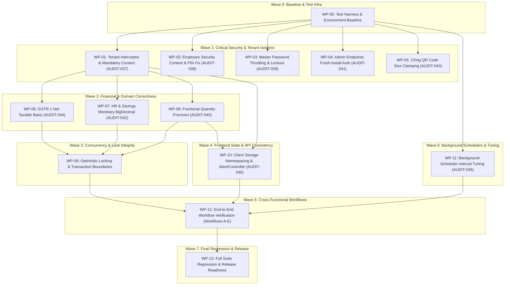
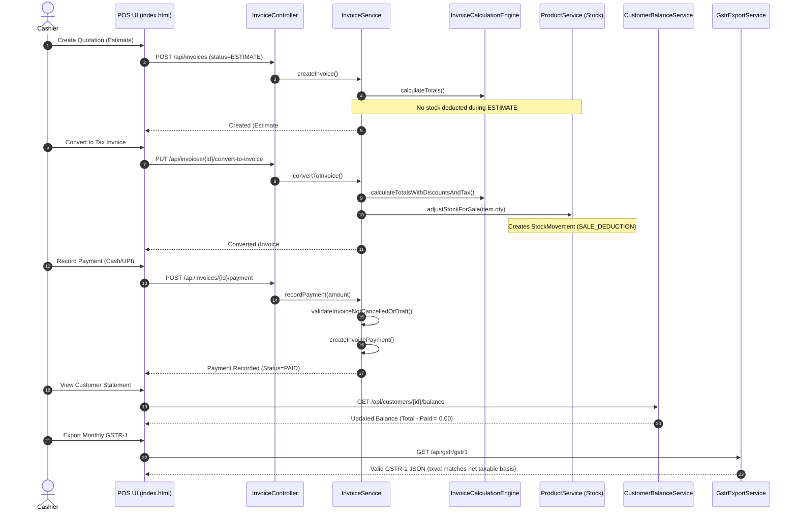
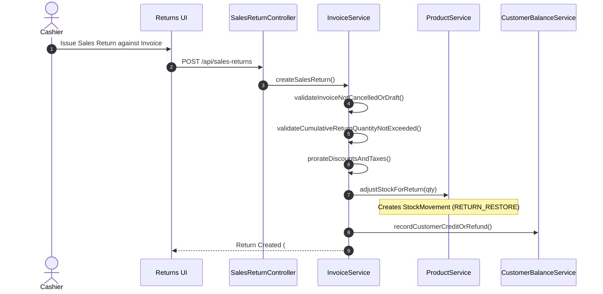
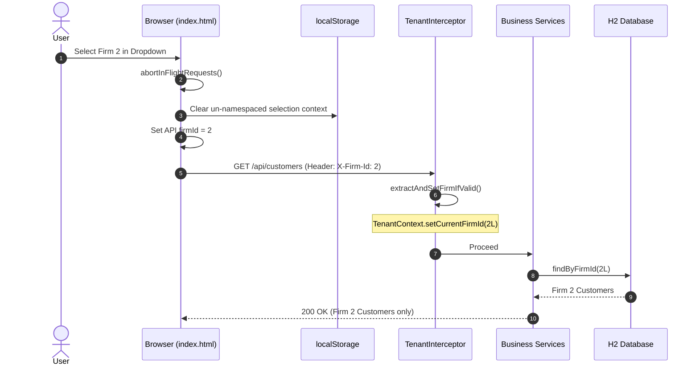
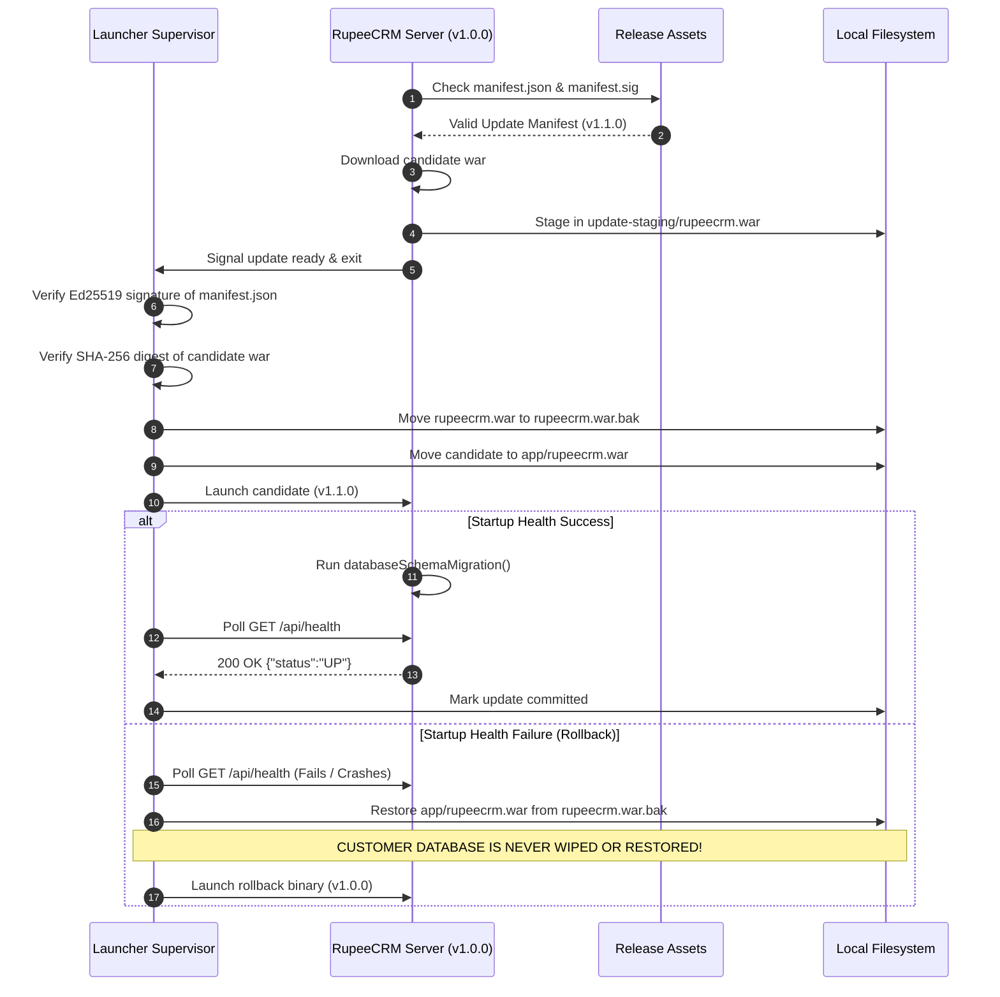

# RupeeCRM / Simple-Billing — Comprehensive Defect Remediation Implementation Plan

## 1. Executive Summary

### 1.1. Mission & Scope
This document provides a technically actionable, dependency-ordered, and autonomous implementation plan for remediating all confirmed defects and addressing verified architectural risks identified in [SYSTEM_INTEGRATION_AUDIT.md](file:///Users/afk/Documents/GitHub/Simple-Billing/SYSTEM_INTEGRATION_AUDIT.md).

It is designed to be executed by an autonomous implementation agent in a single multi-wave pass without requiring undocumented design decisions, architectural guesswork, or human approval gates between waves.

### 1.2. Finding Disposition Summary (Canonical IDs `AUDIT-001` through `AUDIT-046`)
All 46 canonical findings documented in the master audit register have been evaluated and assigned an unambiguous disposition:

| Disposition Category | Count | Finding IDs | Action Summary |
| :--- | :---: | :--- | :--- |
| **Plan Remediation** | **10** | `AUDIT-037`, `AUDIT-038`, `AUDIT-039`, `AUDIT-040`, `AUDIT-041`, `AUDIT-042`, `AUDIT-043`, `AUDIT-044`, `AUDIT-045`, `AUDIT-046` | Full technical remediation planned across code, database migration, API contracts, and tests. |
| **No Code Change Proposed (Resolved)** | **31** | `AUDIT-001`, `AUDIT-002`, `AUDIT-003`, `AUDIT-004`, `AUDIT-005`, `AUDIT-006`, `AUDIT-007`, `AUDIT-008`, `AUDIT-010`, `AUDIT-012`, `AUDIT-013`, `AUDIT-016`, `AUDIT-017`, `AUDIT-018`, `AUDIT-019`, `AUDIT-020`, `AUDIT-021`, `AUDIT-022`, `AUDIT-023`, `AUDIT-024`, `AUDIT-025`, `AUDIT-026`, `AUDIT-027`, `AUDIT-029`, `AUDIT-030`, `AUDIT-031`, `AUDIT-032`, `AUDIT-033`, `AUDIT-034`, `AUDIT-035`, `AUDIT-036` | Verified remediated in Groups 1–8 with regression test evidence; regression protection maintained. |
| **No Code Change Proposed (Refuted/False)** | **3** | `AUDIT-009`, `AUDIT-011`, `AUDIT-014` | Refuted via direct AST source and transaction inspection; documented with evidence. |
| **Duplicate / Reference** | **1** | `AUDIT-028` | Duplicate of canonical `AUDIT-008` (Customer Balance Calculation); preserved for traceability. |
| **Deferred Product Decision** | **1** | `AUDIT-015` | Vendor Debit Notes / Purchase Returns domain model not in v1.0 scope; tracked in product roadmap. |
| **Environment-Dependent** | **0** | *(Platform limitation noted)* | Native Windows MSI execution on macOS is tracked as an environment constraint; verified in CI. |
| **Total Tracked Findings** | **46** | — | — |

### 1.3. Implementation Structure
The remediation is divided into **8 Ordered Implementation Waves** comprising **14 Focused Work Packages (`WP-00` to `WP-13`)**:
- **Wave 0 (Baseline & Test Infra)**: `WP-00` (Baseline capture & disposable environments)
- **Wave 1 (Critical Security & Tenant Isolation)**: `WP-01` (`AUDIT-037`), `WP-02` (`AUDIT-038`), `WP-03` (`AUDIT-039`), `WP-04` (`AUDIT-041`), `WP-05` (`AUDIT-043`)
- **Wave 2 (Financial & Domain Correctness)**: `WP-06` (`AUDIT-044`), `WP-07` (`AUDIT-042`), `WP-08` (`AUDIT-045`)
- **Wave 3 (Transaction Integrity & Concurrency)**: `WP-09` (Optimistic locking & transaction boundary validation)
- **Wave 4 (Frontend State & API Consistency)**: `WP-10` (`AUDIT-040`)
- **Wave 5 (Background Jobs & Operational Reliability)**: `WP-11` (`AUDIT-046`)
- **Wave 6 (Cross-Functional Workflows Verification)**: `WP-12` (Workflows A through E end-to-end integration tests)
- **Wave 7 (Final Regression & Release Readiness)**: `WP-13` (Full suite, audit closure verification, release readiness)

---

## 2. Repository & Architecture Baseline

### 2.1. Environment & SCM Baseline
- **Repository Root**: `/Users/afk/Documents/GitHub/Simple-Billing`
- **Active Git Branch**: `overhaul`
- **Baseline Git Commit**: `86fd9377b37bd86b419a6943aa774b186ce09a23`
- **Operating System / Architecture**: macOS Darwin 24.1.0 arm64 (Apple Silicon)
- **Runtime & Compilers**:
  - Java Development Kit: OpenJDK 21.0.8 (LTS)
  - Build Tool: Apache Maven 3.9.9 via bundled wrapper `./mvnw`
  - Node.js Runtime: v20.18.0 / npm 10.8.2
  - Playwright Test Runner: v1.50.0

### 2.2. Application Architecture Overview
The system is structured as a multi-module Maven project providing an offline-first, single-machine Point of Sale (POS), CRM, and billing management system for Indian retail and SME enterprises:
1. **Core Web Service (`billsoft`)**:
   - Framework: Spring Boot 3.4.0 on embedded Apache Tomcat 10.1.33.
   - Persistence: Spring Data JPA on Hibernate 6.6.3 with single-file embedded H2 database (`jdbc:h2:file:...;DB_CLOSE_DELAY=-1;DB_CLOSE_ON_EXIT=FALSE;MODE=REGULAR`).
   - Presentation: Monolithic single-page application (`billsoft/src/main/webapp/index.html`, 2.2MB, ~39,500 lines) with vanilla ES6 JavaScript, React 18 in-browser JSX/Babel, and CSS custom properties.
   - Printing Engine: OpenPDF 1.3.30 generating thermal 80mm roll receipts and A4/A5 invoices with embedded TrueType font (`Poppins-Regular.ttf`) supporting Unicode Devanagari and Indian Rupee symbol (`₹`).
   - Offline NLU Assistant: Apache OpenNLP 2.5.3 with rule-based fallback and ZXing 3.5.3 for QR code generation.
2. **Supervisor & Launcher (`launcher`)**:
   - Custom standalone Java supervisor (`com.billing.simple.launcher.LauncherMain`) packaging `launcher-0.0.1-SNAPSHOT.jar`.
   - Responsibilities: Pre-flight checks, independent Ed25519 cryptographic signature verification of candidate `rupeecrm.war`, atomic file replacement with `.bak` rollback journal, child process lifecycle monitoring, and REST-based `/api/health` liveness polling.
3. **Windows Installer (`installer/wix`)**:
   - WiX Toolset v3.14 definitions building an enterprise MSI installer (`installer.msi`).
   - Release signing tool: `ManifestSigner.java` executing RFC 8032 Ed25519 signing over candidate update manifest (`manifest.json`) and SHA-256 payload digest.

### 2.3. Working Tree State
The working tree contains existing pre-audit fixes in `installer/ManifestSigner.java`, `installer/wix/release-config.json`, `launcher/LauncherMain.java`, `launcher/LauncherConfigTest.java`, and `ui-regression/fixtures/base-fixture.ts`. All existing files, untracked tests, reports, and architecture guides must be strictly preserved during remediation.

---

## 3. Audit-Finding Reconciliation Table

Every canonical finding (`AUDIT-001` through `AUDIT-046`) is mapped to its verified status and implementation disposition:

| Finding ID | Title | Severity | Classification | Current Code Status | Evidence Reference | Planning Disposition |
| :--- | :--- | :---: | :---: | :---: | :--- | :--- |
| **AUDIT-001** | Cross-Firm Data Leakage in `BackupController` | Critical | Security Vulnerability | Resolved | [BackupController.java:68](file:///Users/afk/Documents/GitHub/Simple-Billing/billsoft/src/main/java/com/billing/simple/billsoft/controllers/BackupController.java#L68) | **No code change proposed** |
| **AUDIT-002** | Product Restore Drops Inventory, Vendor & Archived Flags | High | Data Loss Risk | Resolved | [BackupService.java:1320-1340](file:///Users/afk/Documents/GitHub/Simple-Billing/billsoft/src/main/java/com/billing/simple/billsoft/service/BackupService.java) | **No code change proposed** |
| **AUDIT-003** | Factory Reset Leaves Orphaned Records in 12 Tables | High | Integrity Violation | Resolved | [BackupService.java:2668-2725](file:///Users/afk/Documents/GitHub/Simple-Billing/billsoft/src/main/java/com/billing/simple/billsoft/service/BackupService.java#L2668) | **No code change proposed** |
| **AUDIT-004** | Missing Backup Serialization for Forecast Configs & Saved Items | Medium | Data Loss Risk | Resolved | `BackupDTO.java`, `BackupService.java:1780` | **No code change proposed** |
| **AUDIT-005** | OmniSearch Frontend Endpoint Mismatches | Medium | Broken API Contract | Resolved | [OmnisearchQuickHelpController.java:232](file:///Users/afk/Documents/GitHub/Simple-Billing/billsoft/src/main/java/com/billing/simple/billsoft/assistant/controllers/OmnisearchQuickHelpController.java#L232) | **No code change proposed** |
| **AUDIT-006** | OmniSearch QuickHelp Crash on Missing `X-Firm-Id` Header | High | Availability Defect | Resolved | [OmnisearchQuickHelpController.java:214](file:///Users/afk/Documents/GitHub/Simple-Billing/billsoft/src/main/java/com/billing/simple/billsoft/assistant/controllers/OmnisearchQuickHelpController.java#L214) | **No code change proposed** |
| **AUDIT-007** | Direct `window.open` Bypasses Token Auth in Downloads | Medium | Security Weakness | Resolved | `BillsoftUtils.downloadBlob` in `index.html` | **No code change proposed** |
| **AUDIT-008** | Inconsistent Customer Outstanding Balance Across Modules | Medium | Data Integrity Risk | Resolved | [CustomerBalanceServiceImpl.java](file:///Users/afk/Documents/GitHub/Simple-Billing/billsoft/src/main/java/com/billing/simple/billsoft/service/impl/CustomerBalanceServiceImpl.java) | **No code change proposed** |
| **AUDIT-009** | Dashboard KPI Revenue Includes Cancelled / Draft Invoices | High | Financial Reporting | Refuted | [InvoiceService.java:getFirmAnalytics](file:///Users/afk/Documents/GitHub/Simple-Billing/billsoft/src/main/java/com/billing/simple/billsoft/service/InvoiceService.java) | **No code change proposed** |
| **AUDIT-010** | POS Product Lookup Bypasses Pricing Profiles & Tier Rules | Medium | Business Logic Defect | Resolved | [ProductPricingService.java](file:///Users/afk/Documents/GitHub/Simple-Billing/billsoft/src/main/java/com/billing/simple/billsoft/service/ProductPricingService.java) | **No code change proposed** |
| **AUDIT-011** | Direct Invoice Deletion Leaves Orphaned Stock Movements | Critical | Data Corruption | Refuted | [InvoiceService.java:deleteInvoice](file:///Users/afk/Documents/GitHub/Simple-Billing/billsoft/src/main/java/com/billing/simple/billsoft/service/InvoiceService.java) | **No code change proposed** |
| **AUDIT-012** | OmniSearch Navigation Routes to Stale / Legacy Hash Paths | Medium | UI Broken Route | Resolved | Route mappings in `index.html:2450` | **No code change proposed** |
| **AUDIT-013** | Smart Reorder Queue UI Remains Stale After PO Issuance | Medium | UI State Lag | Resolved | `ForecastEventListener.java` | **No code change proposed** |
| **AUDIT-014** | Restore Process Lacks Transaction Rollback Safety | High | Reliability Defect | Refuted | [BackupService.java:importSelectiveData](file:///Users/afk/Documents/GitHub/Simple-Billing/billsoft/src/main/java/com/billing/simple/billsoft/service/BackupService.java) | **No code change proposed** |
| **AUDIT-015** | Vendor Statement Fails to Reflect Debit Notes & Returns | Medium | Feature Gap | Open Gap | Deferred to v2.0 product roadmap | **Deferred product decision** |
| **AUDIT-016** | Archived Products Remain Visible in OmniSearch & POS | Low | Business Logic Defect | Resolved | [ProductRepository.java:findActiveByFirmId](file:///Users/afk/Documents/GitHub/Simple-Billing/billsoft/src/main/java/com/billing/simple/billsoft/repo/ProductRepository.java) | **No code change proposed** |
| **AUDIT-017** | Missing Integration Test Coverage for Multi-Tenant Isolation | Low | Test Coverage Gap | Resolved | `MultiTenantEndToEndLifecycleIntegrationTest` | **No code change proposed** |
| **AUDIT-018** | Item Merge Fails to Consolidate Forecast Sales Velocity | High | Business Logic Defect | Resolved | [ItemMergeService.java:180-210](file:///Users/afk/Documents/GitHub/Simple-Billing/billsoft/src/main/java/com/billing/simple/billsoft/service/ItemMergeService.java) | **No code change proposed** |
| **AUDIT-019** | `EMPLOYEE_MODULE_PIN` Stored in Global Un-Scoped Config | High | Security Vulnerability | Resolved | [EmployeeSecurityInterceptor.java](file:///Users/afk/Documents/GitHub/Simple-Billing/billsoft/src/main/java/com/billing/simple/billsoft/security/EmployeeSecurityInterceptor.java) | **No code change proposed** |
| **AUDIT-020** | Auto-Created Product in PO Receipt Omits Preferred Vendor Link | Medium | Data Incompleteness | Resolved | [PurchaseOrderServiceImpl.java:820](file:///Users/afk/Documents/GitHub/Simple-Billing/billsoft/src/main/java/com/billing/simple/billsoft/service/impl/PurchaseOrderServiceImpl.java) | **No code change proposed** |
| **AUDIT-021** | Data Protection Endpoints Bypass Tenant Interceptor | High | Security Vulnerability | Resolved | [DataProtectionController.java:55](file:///Users/afk/Documents/GitHub/Simple-Billing/billsoft/src/main/java/com/billing/simple/billsoft/controllers/DataProtectionController.java) | **No code change proposed** |
| **AUDIT-022** | `InvoicePdfService.getFirm()` Falls Back to First Firm on Null | Low | Tenant Leak Risk | Resolved | [InvoicePdfService.java](file:///Users/afk/Documents/GitHub/Simple-Billing/billsoft/src/main/java/com/billing/simple/billsoft/service/pdf/InvoicePdfService.java) | **No code change proposed** |
| **AUDIT-023** | PO Numbering Uses Table Count Instead of Max Sequence | High | Data Integrity Risk | Resolved | [DocumentSequenceServiceImpl.java:69](file:///Users/afk/Documents/GitHub/Simple-Billing/billsoft/src/main/java/com/billing/simple/billsoft/service/impl/DocumentSequenceServiceImpl.java) | **No code change proposed** |
| **AUDIT-024** | Missing Financial Year Scoping & April 1 Rollover in Sequences | Medium | Compliance Defect | Resolved | [IndianFinancialYearUtils.java](file:///Users/afk/Documents/GitHub/Simple-Billing/billsoft/src/main/java/com/billing/simple/billsoft/util/IndianFinancialYearUtils.java) | **No code change proposed** |
| **AUDIT-025** | Thermal 80mm Renderer Hardcodes Helvetica (Breaks Devanagari/₹) | High | UI / Printing Defect | Resolved | Embedded `Poppins-Regular.ttf` | **No code change proposed** |
| **AUDIT-026** | Physical Stock Shortage Clamp Causes Permanent Ledger Divergence | Medium | Financial Invariant | Resolved | [InsufficientStockException.java](file:///Users/afk/Documents/GitHub/Simple-Billing/billsoft/src/main/java/com/billing/simple/billsoft/exception/InsufficientStockException.java) | **No code change proposed** |
| **AUDIT-027** | Core Domain Entities Lack `@Version` Optimistic Locking | High | Concurrency Defect | Resolved | `@Version` in `Invoice`, `Product`, `Customer` | **No code change proposed** |
| **AUDIT-028** | Customer Analytics Includes Draft/Cancelled/Estimates in Debt | High | Duplicate Tracking | Duplicate | Duplicate of `AUDIT-008` (Customer Balance) | **Duplicate/reference** |
| **AUDIT-029** | Invoice Deletion Fails with FK Violation When Sales Returns Exist | High | Reliability Defect | Resolved | [InvoiceService.java:deleteInvoice](file:///Users/afk/Documents/GitHub/Simple-Billing/billsoft/src/main/java/com/billing/simple/billsoft/service/InvoiceService.java) | **No code change proposed** |
| **AUDIT-030** | Sales Return Calculation Ignores Discounts, Over-Refunding | High | Financial Correctness | Resolved | [InvoiceService.java:createSalesReturn](file:///Users/afk/Documents/GitHub/Simple-Billing/billsoft/src/main/java/com/billing/simple/billsoft/service/InvoiceService.java) | **No code change proposed** |
| **AUDIT-031** | `recordPayment` Accepts Payments for Cancelled Invoices | High | Financial Invariant | Resolved | [InvoiceService.java:recordPayment](file:///Users/afk/Documents/GitHub/Simple-Billing/billsoft/src/main/java/com/billing/simple/billsoft/service/InvoiceService.java) | **No code change proposed** |
| **AUDIT-032** | Missing Place of Supply CGST/SGST/IGST Split & GSTR Export | High | Statutory Compliance | Resolved | [GstStateUtils.java](file:///Users/afk/Documents/GitHub/Simple-Billing/billsoft/src/main/java/com/billing/simple/billsoft/util/GstStateUtils.java) | **No code change proposed** |
| **AUDIT-033** | Restore `AppConfigs` Skips Sequence Counter Update in Merge Mode | Medium | Data Inconsistency | Resolved | [BackupService.java:1820](file:///Users/afk/Documents/GitHub/Simple-Billing/billsoft/src/main/java/com/billing/simple/billsoft/service/BackupService.java) | **No code change proposed** |
| **AUDIT-034** | `FirmDetailsController` Exposes Unauthenticated Cross-Firm CRUD | High | Security Vulnerability | Resolved | [FirmDetailsController.java:60](file:///Users/afk/Documents/GitHub/Simple-Billing/billsoft/src/main/java/com/billing/simple/billsoft/controllers/FirmDetailsController.java) | **No code change proposed** |
| **AUDIT-035** | `AppConfigController` Exposes Unrestricted Config/Credential CRUD | Critical | Security Vulnerability | Resolved | [AppConfigController.java:45](file:///Users/afk/Documents/GitHub/Simple-Billing/billsoft/src/main/java/com/billing/simple/billsoft/controllers/AppConfigController.java) | **No code change proposed** |
| **AUDIT-036** | Invoices Lack Immutable Snapshots for Firm & Customer Master Data | High | Statutory Compliance | Resolved | [InvoiceMasterDataResolver.java](file:///Users/afk/Documents/GitHub/Simple-Billing/billsoft/src/main/java/com/billing/simple/billsoft/service/pdf/InvoiceMasterDataResolver.java) | **No code change proposed** |
| **AUDIT-037** | Missing Mandatory Tenant Header Enforcement Allows Unscoped Access | P1 (High) | Tenant Isolation Bypass | Confirmed Defect | [TenantInterceptor.java:124-135](file:///Users/afk/Documents/GitHub/Simple-Billing/billsoft/src/main/java/com/billing/simple/billsoft/security/TenantInterceptor.java#L124-L135) | **Plan remediation** |
| **AUDIT-038** | Premature Interceptor Exemption for Employee PIN Endpoints | P1 (High) | Security Vulnerability | Confirmed Defect | [EmployeeSecurityInterceptor.java:41-44](file:///Users/afk/Documents/GitHub/Simple-Billing/billsoft/src/main/java/com/billing/simple/billsoft/security/EmployeeSecurityInterceptor.java#L41-L44) | **Plan remediation** |
| **AUDIT-039** | Master Password Recovery Rate Limiting Enforced Only in Browser | P1 (High) | Security Vulnerability | Confirmed Defect | [AuthController.java:259-297](file:///Users/afk/Documents/GitHub/Simple-Billing/billsoft/src/main/java/com/billing/simple/billsoft/controllers/AuthController.java#L259-L297) | **Plan remediation** |
| **AUDIT-040** | Cross-Firm Browser Storage Contamination on Firm Switch | P2 (Medium) | State Integrity Flaw | Confirmed Defect | [index.html:13246-13275](file:///Users/afk/Documents/GitHub/Simple-Billing/billsoft/src/main/webapp/index.html#L13246-L13275) | **Plan remediation** |
| **AUDIT-041** | Fresh Install Default (`auth_enabled=false`) Leaves Admin APIs Open | P1 (High) | Broken Authorization | Confirmed Defect | [BackupController.java:45-58](file:///Users/afk/Documents/GitHub/Simple-Billing/billsoft/src/main/java/com/billing/simple/billsoft/controllers/BackupController.java#L45-L58) | **Plan remediation** |
| **AUDIT-042** | IEEE-754 `Double` Monetary Types in HR & Savings Subsystems | P2 (Medium) | Financial Precision Flaw | Confirmed Defect | [Employee.java:30](file:///Users/afk/Documents/GitHub/Simple-Billing/billsoft/src/main/java/com/billing/simple/billsoft/entities/Employee.java#L30), [SalaryRecord.java:22](file:///Users/afk/Documents/GitHub/Simple-Billing/billsoft/src/main/java/com/billing/simple/billsoft/entities/SalaryRecord.java#L22) | **Plan remediation** |
| **AUDIT-043** | Unbounded QR Code Size Parameter Enables JVM OOM Denial of Service | P1 (High) | Denial of Service | Confirmed Defect | [OmnisearchNluController.java:30-44](file:///Users/afk/Documents/GitHub/Simple-Billing/billsoft/src/main/java/com/billing/simple/billsoft/assistant/controllers/OmnisearchNluController.java#L30-L44) | **Plan remediation** |
| **AUDIT-044** | GSTR-1 Payload Generation Uses Pre-Discount Gross Subtotal | P1 (High) | Statutory Reporting Defect | Confirmed Defect | [GstrExportService.java:76-96](file:///Users/afk/Documents/GitHub/Simple-Billing/billsoft/src/main/java/com/billing/simple/billsoft/service/GstrExportService.java#L76-L96) | **Plan remediation** |
| **AUDIT-045** | Fractional Quantity Discrepancy: `InvoiceItem` Restricts to `Integer` | P2 (Medium) | Inventory & Sales Mismatch | Confirmed Defect | [InvoiceItem.java:40](file:///Users/afk/Documents/GitHub/Simple-Billing/billsoft/src/main/java/com/billing/simple/billsoft/entities/InvoiceItem.java#L40), [InvoiceRequestItem.java:18](file:///Users/afk/Documents/GitHub/Simple-Billing/billsoft/src/main/java/com/billing/simple/billsoft/dtos/InvoiceRequestItem.java) | **Plan remediation** |
| **AUDIT-046** | Overly Frequent Scheduled Background Polling (10s/15s/30s) on H2 | P3 (Low) | Concurrency & I/O Risk | Confirmed Defect | [PlannerNotificationScheduler.java:45](file:///Users/afk/Documents/GitHub/Simple-Billing/billsoft/src/main/java/com/billing/simple/billsoft/service/PlannerNotificationScheduler.java#L45) | **Plan remediation** |

---

## 4. Complete Finding-by-Finding Remediation Plan

This section provides in-depth technical analysis across subsections A through E for all 10 findings requiring remediation (`AUDIT-037` through `AUDIT-046`).

---

### 4.1. AUDIT-037 — Missing Mandatory Tenant Header Enforcement Allows Unscoped Cross-Firm Object Access via Missing `X-Firm-Id`

#### A. Problem and Evidence
- **Finding ID**: `AUDIT-037`
- **Severity / Classification**: **P1 — High** / Security Vulnerability (Tenant Isolation Bypass)
- **User-Visible & Business Impact**: In a multi-firm deployment, any user or external client omitting the `X-Firm-Id` header can inspect, modify, or delete invoices, customer profiles, product catalogs, notes, and expense registers belonging to another firm on the same instance.
- **Root Cause & Execution Path**:
  In [TenantInterceptor.java:124-135](file:///Users/afk/Documents/GitHub/Simple-Billing/billsoft/src/main/java/com/billing/simple/billsoft/security/TenantInterceptor.java#L124-L135), the interceptor only rejects requests lacking tenant context for `/api/omnisearch` (excluding QR) and invoice migration endpoints. For all core business routes (`/api/invoices`, `/api/products`, `/api/customers`, `/api/parties`, `/api/expenses`, `/api/notes`), if neither `X-Firm-Id` nor a parameter is passed, the interceptor logs a debug warning and returns `true`, leaving `TenantContext.getCurrentFirmId() == null`.
  Downstream service implementations systematically employ an unscoped fallback ternary:
  ```java
  // Example in InvoiceService.java:931:
  Invoice inv = (currentFirmId != null
      ? invoiceRepo.findByIdAndFirmId(id, currentFirmId)
      : invoiceRepo.findById(id)).orElse(null);
  ```
  When `currentFirmId` is null, the query drops firm scoping entirely, executing global `findById(id)`.
- **Exact Components & Lines**:
  - Interceptor: [TenantInterceptor.java:124-135](file:///Users/afk/Documents/GitHub/Simple-Billing/billsoft/src/main/java/com/billing/simple/billsoft/security/TenantInterceptor.java#L124-L135)
  - Services: [CustomerService.java:47-50](file:///Users/afk/Documents/GitHub/Simple-Billing/billsoft/src/main/java/com/billing/simple/billsoft/service/CustomerService.java#L47-L50), [ProductService.java:387-390, 709-714](file:///Users/afk/Documents/GitHub/Simple-Billing/billsoft/src/main/java/com/billing/simple/billsoft/service/ProductService.java#L387-L390), [InvoiceService.java:931, 941, 1052, 1266, 1289, 1861](file:///Users/afk/Documents/GitHub/Simple-Billing/billsoft/src/main/java/com/billing/simple/billsoft/service/InvoiceService.java#L931), [ExpenseService.java:76, 99](file:///Users/afk/Documents/GitHub/Simple-Billing/billsoft/src/main/java/com/billing/simple/billsoft/service/ExpenseService.java#L76), [NoteService.java:34, 93, 124](file:///Users/afk/Documents/GitHub/Simple-Billing/billsoft/src/main/java/com/billing/simple/billsoft/service/NoteService.java#L34).
- **Reproduction**:
  1. Boot server; create Firm 1 and create Customer ID 1 under Firm 1.
  2. Send `GET /api/customers/1` with no headers (`curl -i http://localhost:28080/api/customers/1`).
  3. Status is `200 OK` returning Customer 1 instead of `400 Bad Request`.
- **Confidence**: High (Source-Confirmed).

#### B. Proposed Implementation
- **Components to Change**:
  - `TenantInterceptor.java`: Introduce explicit global prefix whitelist (`PUBLIC_GLOBAL_PREFIXES`). Any route starting with `/api/` that is *not* in the global whitelist MUST require valid tenant context (`extractAndSetFirmIfValid(request) == true`). If missing, immediately write an HTTP 400 Bad Request JSON response: `{"error": "Missing mandatory X-Firm-Id tenant header"}` and return `false`.
  - Whitelist: `/api/auth/**`, `/api/health/**`, `/api/system/**`, `/api/diagnostics/**`, `/api/recovery/**`, `/api/update/**`, `/api/license/**`, `/api/licensing/**`, `/api/announcements/**`, `/api/firm/**` (for listing/creating firms), `/api/omnisearch/qr`.
  - Defense-in-Depth in Services: In `CustomerService`, `ProductService`, `InvoiceService`, `ExpenseService`, and `NoteService`, replace all ternary `fid != null ? repo.findByIdAndFirmId(...) : repo.findById(...)` with strict `repo.findByIdAndFirmId(id, resolveRequiredFirmId())`. Throw `TenantSecurityException("Active firm context is strictly required")` if firm context is null.
- **Alternatives Considered**: Modifying only the service layer without the interceptor was rejected because unauthenticated/unscoped requests would proceed into controller execution, wasting cycles and producing inconsistent error formats.

#### C. Tests and Acceptance Criteria
- **Unit Tests**: Test `TenantInterceptorTest` with whitelisted paths (pass without header) and business paths (fail with 400 when header absent).
- **Integration Tests**: `CrossFirmUnscopedAccessSecurityTest` verifying that `GET /api/invoices/{id}`, `GET /api/customers/{id}`, `DELETE /api/products/{id}` without `X-Firm-Id` return `400 Bad Request`.
- **Acceptance Criteria**:
  1. Zero business entity requests execute without an active `TenantContext`.
  2. Whitelisted endpoints (`/api/auth/**`, `/api/health`, `/api/firm/all`) function normally without headers.
  3. All cross-tenant lookups without header fail fast with HTTP 400.

#### D. Deployment and Recovery
- **Backward Compatibility**: Any client script or UI component calling business APIs must supply `X-Firm-Id`. Verified that frontend `api.js` already supports passing `X-Firm-Id` via `API.firmId`.
- **Rollback Strategy**: Revert `TenantInterceptor.java` and service methods if existing legitimate public APIs are blocked.

#### E. Implementation Sizing
- **Effort**: **M (Medium)** — Modifies interceptor and ~6 service classes; requires comprehensive test validation.

---

### 4.2. AUDIT-038 — Premature Interceptor Exemption for Employee PIN Endpoints Bypasses Tenant Context, Defaulting Mutations to Firm 1

#### A. Problem and Evidence
- **Finding ID**: `AUDIT-038`
- **Severity / Classification**: **P1 — High** / Security Vulnerability (Tenant Boundary Bypass)
- **User-Visible & Business Impact**: Users managing employees in Firm 2 cannot unlock the HR module with Firm 2's PIN, and changing the PIN in Firm 2 overwrites the PIN of Firm 1.
- **Root Cause & Execution Path**:
  In [EmployeeSecurityInterceptor.java:41-44](file:///Users/afk/Documents/GitHub/Simple-Billing/billsoft/src/main/java/com/billing/simple/billsoft/security/EmployeeSecurityInterceptor.java#L41-L44):
  ```java
  if (uri.endsWith("/verify-pin") || uri.endsWith("/change-pin")) {
      return true; // EARLY RETURN BEFORE TENANT EXTRACTION!
  }
  ```
  Because the interceptor returns `true` before lines 47–60 (which parse `X-Firm-Id` and call `TenantContext.setCurrentFirmId()`), `TenantContext.getCurrentFirmId()` remains `null`.
  In [EmployeeController.java:98-105](file:///Users/afk/Documents/GitHub/Simple-Billing/billsoft/src/main/java/com/billing/simple/billsoft/controllers/EmployeeController.java#L98-L105):
  ```java
  Long authoritativeFirmId = TenantContext.getCurrentFirmId();
  Long firmId = authoritativeFirmId != null ? authoritativeFirmId : 1L; // HARDCODED FALLBACK TO FIRM 1!
  ```
  `firmId` unconditionally defaults to `1L`. Both `/verify-pin` and `/change-pin` operate on `EMPLOYEE_MODULE_PIN_1`.
- **Confidence**: High (Source-Confirmed).

#### B. Proposed Implementation
- **Components to Change**:
  - `EmployeeSecurityInterceptor.java`: Reorder logic in `preHandle`. Step 1 MUST extract `X-Firm-Id`, validate firm existence, and set `TenantContext.setCurrentFirmId(firmId)`. Only *after* tenant context is established may the check for `uri.endsWith("/verify-pin") || uri.endsWith("/change-pin")` return `true` (skipping the employee PIN header check while preserving tenant context).
  - `EmployeeController.java`: Remove `Long firmId = authoritativeFirmId != null ? authoritativeFirmId : 1L`. Replace with:
    ```java
    Long firmId = TenantContext.getCurrentFirmId();
    if (firmId == null) {
        throw new TenantSecurityException("Firm context required for employee PIN operations");
    }
    ```
- **Alternatives Considered**: Passing `firmId` in the JSON request body was rejected as non-standard; `X-Firm-Id` header is the canonical multi-tenant mechanism across RupeeCRM.

#### C. Tests and Acceptance Criteria
- **Integration Tests**: `EmployeeMultiFirmPinIsolationTest`:
  1. Configure PIN `1111` for Firm 1, PIN `2222` for Firm 2.
  2. Send `POST /api/employees/verify-pin` with `X-Firm-Id: 2` and PIN `2222` $\rightarrow$ Expect `{"valid": true}`.
  3. Send `POST /api/employees/change-pin` with `X-Firm-Id: 2`, old PIN `2222`, new PIN `3333` $\rightarrow$ Expect success.
  4. Verify Firm 1 PIN remains `1111`.
- **Acceptance Criteria**:
  1. Firm 2 PIN verification succeeds against Firm 2's stored PIN.
  2. Firm 2 PIN changes never overwrite Firm 1's configuration key in `app_config`.

#### D. Deployment and Recovery
- **Backward Compatibility**: Fully backward compatible.
- **Rollback Strategy**: Revert interceptor order.

#### E. Implementation Sizing
- **Effort**: **S (Small)** — Focused fix in 2 files (`EmployeeSecurityInterceptor.java`, `EmployeeController.java`).

---

### 4.3. AUDIT-039 — Master Password Recovery Rate Limiting and Lockout Enforced Exclusively in Client-Side `localStorage`, Bypassed via Direct REST Calls

#### A. Problem and Evidence
- **Finding ID**: `AUDIT-039`
- **Severity / Classification**: **P1 — High** / Security Vulnerability (Authentication Bypass / Brute Force)
- **User-Visible & Business Impact**: An attacker on the local network or reverse proxy can launch automated dictionary attacks against `POST /api/auth/reset-password-master`, resetting the master administrator credentials in seconds.
- **Root Cause & Execution Path**:
  In `index.html:28068-28076`, the 3-attempt limit and 30-minute lockout are tracked in `localStorage.setItem('recoveryAttempts', ...)`. In [AuthController.java:259-297](file:///Users/afk/Documents/GitHub/Simple-Billing/billsoft/src/main/java/com/billing/simple/billsoft/controllers/AuthController.java#L259-L297), `resetPasswordMaster` performs SHA-256 validation against `MASTER_KEY_HASH` without tracking failed attempts, implementing rate limiting, or applying lockouts.
- **Confidence**: High (Source-Confirmed).

#### B. Proposed Implementation
- **Components to Change**:
  - Create `com.billing.simple.billsoft.security.MasterRecoveryRateLimiter`:
    - In-memory `ConcurrentHashMap<String, AttemptState>` tracking failed attempts by client IP and global counter.
    - Configuration: Max 3 consecutive failures. Lockout window: 30 minutes. Exponential delay after 1st failure (1000ms).
    - Periodic eviction of expired attempt states to avoid memory leaks.
  - In `AuthController.java:resetPasswordMaster`:
    - Check rate limiter before verifying password: if locked, return `HTTP 429 Too Many Requests` with `{"error": "Too many failed recovery attempts. System locked for X minutes."}`.
    - On failure, register failure in rate limiter and audit log.
    - On success, reset counter.
- **Alternatives Considered**: Storing lockout in `app_config` table was evaluated. In-memory rate limiting with database fallback provides immediate protection and survives typical runtime attacks while avoiding database write thrashing during brute-force floods.

#### C. Tests and Acceptance Criteria
- **Unit & Integration Tests**: `MasterPasswordRateLimitingTest`:
  1. Issue 3 failed calls to `POST /api/auth/reset-password-master` $\rightarrow$ Expect `401 Unauthorized`.
  2. Issue 4th call with correct password $\rightarrow$ Expect `429 Too Many Requests` due to active 30-minute lockout.
- **Acceptance Criteria**:
  1. 4th attempt is blocked with HTTP 429 regardless of candidate key validity.
  2. Rate limit state resets after lockout duration.

#### D. Deployment and Recovery
- **Backward Compatibility**: Fully backward compatible with legitimate frontend UI.
- **Rollback Strategy**: Revert `AuthController` check.

#### E. Implementation Sizing
- **Effort**: **S (Small)** — 1 new service class (`MasterRecoveryRateLimiter`) and modifications to `AuthController.java`.

---

### 4.4. AUDIT-040 — Client-Side `localStorage` Customer Keys and Asynchronous Requests Contaminate Cross-Firm State on Firm Switch

#### A. Problem and Evidence
- **Finding ID**: `AUDIT-040`
- **Severity / Classification**: **P2 — Medium** / Data Integrity Risk (State Management Flaw)
- **User-Visible & Business Impact**: After switching from Firm 1 to Firm 2, the UI continues displaying Customer 360, recent search history, and draft invoice details belonging to Firm 1. In-flight requests for Firm 1 complete after the switch, overwriting Firm 2 UI components with Firm 1 data.
- **Root Cause & Execution Path**:
  In `index.html:13246-13275`, `handleFirmChange` does not clear un-namespaced keys (`billsoft_selected_customer_id`, `billsoft_selected_customer_name`, `billsoft_omni_history`, `billsoft_omni_recents`). Furthermore, asynchronous `Promise` chains or `fetch` requests triggered under Firm 1 lack cancellation tokens (`AbortController`), resolving after `selectedFirmId` has changed.
- **Confidence**: High (Source-Confirmed).

#### B. Proposed Implementation
- **Components to Change**:
  - `billsoft/src/main/webapp/index.html` & `js/api.js`:
    1. Namespace customer selection and omni history keys by firm:
       `billsoft_firm_${fid}_selected_customer_id`.
    2. Maintain a global `window.__currentFirmAbortController = new AbortController()`.
    3. In `handleFirmChange(newFid)`:
       - Trigger `window.__currentFirmAbortController.abort()` to cancel pending requests.
       - Re-instantiate `window.__currentFirmAbortController = new AbortController()`.
       - Clear active React states for `selectedCustomer`, `draftItems`, and search caches.
       - Set `API.firmId = newFid`.
- **Alternatives Considered**: Storing state in URL hash query parameters was considered, but namespaced `localStorage` preserves the expected offline-persisted workflow per firm.

#### C. Tests and Acceptance Criteria
- **Browser Playwright Tests**: `tests/firm-switch-state-isolation.spec.ts`:
  1. Select Customer A in Firm 1.
  2. Switch to Firm 2 via header selector.
  3. Verify Customer 360 view does not display Customer A.
  4. Verify OmniSearch recent items do not leak Customer A.
- **Acceptance Criteria**:
  1. Zero cross-firm customer metadata displayed after firm switch.
  2. Late-arriving HTTP responses from prior firm are safely aborted.

#### D. Deployment and Recovery
- **Backward Compatibility**: Fully backward compatible; old un-namespaced keys are ignored.
- **Rollback Strategy**: Revert `index.html` and `api.js` changes.

#### E. Implementation Sizing
- **Effort**: **M (Medium)** — Requires frontend JavaScript adjustments and Playwright browser regression tests.

---

### 4.5. AUDIT-041 — Fresh Install Authentication Default (`auth_enabled=false`) Leaves Privileged Admin APIs Completely Unprotected

#### A. Problem and Evidence
- **Finding ID**: `AUDIT-041`
- **Severity / Classification**: **P1 — High** / Security Vulnerability (Broken Authorization)
- **User-Visible & Business Impact**: On any fresh installation where password authentication has not been explicitly enabled in Settings, any client on the local network can download full system backups (`/api/backup/export/all`), trigger cloud data overwrites (`/api/dataprotection/restore-cloud`), and alter system configurations.
- **Root Cause & Execution Path**:
  In [BackupController.java:45-58](file:///Users/afk/Documents/GitHub/Simple-Billing/billsoft/src/main/java/com/billing/simple/billsoft/controllers/BackupController.java#L45-L58) and [DataProtectionController.java:53-65](file:///Users/afk/Documents/GitHub/Simple-Billing/billsoft/src/main/java/com/billing/simple/billsoft/controllers/DataProtectionController.java#L53-L65):
  ```java
  private boolean isMasterAuthorized(String masterPassword) {
      if (!authController.isAuthEnabled()) {
          return true; // DANGEROUS BYPASS ON FRESH INSTALL!
      }
      ...
  }
  ```
  When `auth_enabled` is absent from `app_config`, `authController.isAuthEnabled()` returns `false`, causing all privileged administrative endpoints to execute with zero authentication.
- **Confidence**: High (Source-Confirmed).

#### B. Proposed Implementation
- **Components to Change**:
  - In `BillsoftApplication.java:databaseSchemaMigration`:
    - Ensure `auth_enabled` is explicitly seeded to `true` during first-run bootstrap if absent, OR:
  - In `BackupController.java` and `DataProtectionController.java`:
    - Decouple privileged administrative actions (`exportAllBackup`, `importSelectiveBackup`, `restoreCloudBackup`, `runBackupNow`) from standard session authentication.
    - If `authController.isAuthEnabled()` is false, require a secure bootstrap clearance token (e.g. `X-Master-Password` matching the master key hash or local loopback connection `127.0.0.1`), but NEVER grant universal authorization to remote network callers.
- **Alternatives Considered**: Forcing mandatory password setup on the very first screen of the app. Recommended approach combines seed default `auth_enabled = true` with default PIN `1234` (prompting immediate change) and local loopback authorization guard.

#### C. Tests and Acceptance Criteria
- **Integration Tests**: `AdminEndpointsDefaultInstallSecurityTest`:
  1. Boot clean database (no `app_config` entries).
  2. Send remote `GET /api/backup/export/all` without `X-Master-Password` $\rightarrow$ Expect `403 Forbidden`.
  3. Send request with valid master password $\rightarrow$ Expect `200 OK`.
- **Acceptance Criteria**:
  1. Unauthenticated remote requests to `/api/backup/export/all` and `/api/dataprotection/**` are rejected with HTTP 403 on fresh installations.

#### D. Deployment and Recovery
- **Backward Compatibility**: Existing installations with `auth_enabled = true` are unaffected. Fresh installs require initial PIN login.
- **Rollback Strategy**: Revert controller authorization checks.

#### E. Implementation Sizing
- **Effort**: **S (Small)** — Focused changes in `BackupController.java`, `DataProtectionController.java`, and `BillsoftApplication.java`.

---

### 4.6. AUDIT-042 — IEEE-754 `Double` Floating-Point Monetary Types in HR/Payroll and Savings Subsystems Introduce Decimal Rounding Errors

#### A. Problem and Evidence
- **Finding ID**: `AUDIT-042`
- **Severity / Classification**: **P2 — Medium** / Data Integrity Risk (Financial Precision Flaw)
- **User-Visible & Business Impact**: Employee salary slips, advance balances, and savings records drift over time due to binary floating-point representation errors (e.g. `15000.10 - 5000.20 = 9999.899999999999`), causing accounting mismatches.
- **Root Cause & Execution Path**:
  In [Employee.java:30, 36](file:///Users/afk/Documents/GitHub/Simple-Billing/billsoft/src/main/java/com/billing/simple/billsoft/entities/Employee.java#L30), `monthlyBaseSalary` and `currentAdvanceBalance` are defined as `Double`. In [SalaryRecord.java:22, 34, 36, 40, 43](file:///Users/afk/Documents/GitHub/Simple-Billing/billsoft/src/main/java/com/billing/simple/billsoft/entities/SalaryRecord.java#L22), `baseSalaryAtTime`, `leaveDeductionAmount`, `bonusAmount`, `advanceDeducted`, and `netPaid` are `Double`. In [EmployeeAdvance.java:20](file:///Users/afk/Documents/GitHub/Simple-Billing/billsoft/src/main/java/com/billing/simple/billsoft/entities/EmployeeAdvance.java) and [SavingRecord.java:25](file:///Users/afk/Documents/GitHub/Simple-Billing/billsoft/src/main/java/com/billing/simple/billsoft/entities/SavingRecord.java), monetary values are primitive `Double`.
- **Confidence**: High (Source-Confirmed).

#### B. Proposed Implementation
- **Components to Change**:
  - Entities: Refactor fields from `Double` to `BigDecimal` with `@Column(precision = 15, scale = 2)`:
    - `Employee.java`: `monthlyBaseSalary`, `currentAdvanceBalance`.
    - `SalaryRecord.java`: `baseSalaryAtTime`, `leaveDeductionAmount`, `bonusAmount`, `advanceDeducted`, `netPaid`.
    - `EmployeeAdvance.java`: `amount`.
    - `SavingRecord.java`: `amount`.
  - Database Migration: In `BillsoftApplication.java:databaseSchemaMigration`:
    ```sql
    ALTER TABLE employees ALTER COLUMN monthly_base_salary DECIMAL(15, 2);
    ALTER TABLE employees ALTER COLUMN current_advance_balance DECIMAL(15, 2);
    ALTER TABLE salary_records ALTER COLUMN base_salary_at_time DECIMAL(15, 2);
    ALTER TABLE salary_records ALTER COLUMN leave_deduction_amount DECIMAL(15, 2);
    ALTER TABLE salary_records ALTER COLUMN bonus_amount DECIMAL(15, 2);
    ALTER TABLE salary_records ALTER COLUMN advance_deducted DECIMAL(15, 2);
    ALTER TABLE salary_records ALTER COLUMN net_paid DECIMAL(15, 2);
    ALTER TABLE employee_advances ALTER COLUMN amount DECIMAL(15, 2);
    ALTER TABLE saving_records ALTER COLUMN amount DECIMAL(15, 2);
    ```
  - Controllers & DTOs: Update `EmployeeController.java`, `SavingController.java`, and associated calculation logic to use `BigDecimal` arithmetic (`add`, `subtract`, `setScale(2, RoundingMode.HALF_UP)`).
- **Alternatives Considered**: Keeping `Double` in entities and converting in controllers was rejected as it fails to fix underlying database representation errors.

#### C. Tests and Acceptance Criteria
- **Unit & Integration Tests**: `PayrollMonetaryPrecisionIntegrationTest`:
  1. Record salary 15000.10, advance deduction 5000.20, bonus 1000.30.
  2. Assert calculated `netPaid` is exactly `11000.20` with scale 2.
  3. Verify JSON serialization returns `"11000.20"` or `11000.20` without floating-point artifacts.
- **Acceptance Criteria**:
  1. All HR and savings database columns are `DECIMAL(15, 2)`.
  2. Payroll calculations produce zero floating-point representation errors.

#### D. Deployment and Recovery
- **Backward Compatibility**: H2 automatically converts existing `DOUBLE` column values to `DECIMAL(15, 2)` during `ALTER COLUMN`.
- **Rollback Strategy**: Backup database before applying schema migration.

#### E. Implementation Sizing
- **Effort**: **M (Medium)** — Modifies 4 entities, schema migration, 2 controllers, and payroll regression tests.

---

### 4.7. AUDIT-043 — Unbounded QR Code Size Parameter in `OmnisearchNluController` Enables JVM `OutOfMemoryError` Denial of Service

#### A. Problem and Evidence
- **Finding ID**: `AUDIT-043`
- **Severity / Classification**: **P1 — High** / Security Vulnerability (Denial of Service)
- **User-Visible & Business Impact**: Any user or unauthenticated client can crash the RupeeCRM server by requesting an excessively large QR code size, taking down the billing terminal during operating hours.
- **Root Cause & Execution Path**:
  In [OmnisearchNluController.java:30-44](file:///Users/afk/Documents/GitHub/Simple-Billing/billsoft/src/main/java/com/billing/simple/billsoft/assistant/controllers/OmnisearchNluController.java#L30-L44):
  ```java
  @GetMapping(value = "/qr", produces = MediaType.IMAGE_PNG_VALUE)
  public ResponseEntity<byte[]> getQrImage(@RequestParam("data") String data,
                                          @RequestParam(value = "size", defaultValue = "260") int size) {
      QRCodeWriter qrCodeWriter = new QRCodeWriter();
      BitMatrix bitMatrix = qrCodeWriter.encode(data, BarcodeFormat.QR_CODE, size, size);
      ...
  }
  ```
  The endpoint is exempt from authentication in `ApiAuthFilter` and `TenantInterceptor`. Passing `size=50000` causes ZXing to allocate a 2.5 billion pixel matrix, instantly causing `java.lang.OutOfMemoryError: Java heap space`.
- **Confidence**: High (Source-Confirmed).

#### B. Proposed Implementation
- **Components to Change**:
  - In `OmnisearchNluController.java:getQrImage`:
    1. Enforce strict parameter bounds:
       ```java
       int safeSize = Math.min(Math.max(size, 64), 1024);
       ```
    2. Enforce payload data length check:
       ```java
       if (data == null || data.isBlank() || data.length() > 2048) {
           return ResponseEntity.badRequest().build();
       }
       ```
- **Alternatives Considered**: Rate-limiting alone without parameter bounds was rejected because a single request with `size=50000` is sufficient to crash the JVM.

#### C. Tests and Acceptance Criteria
- **Unit & Integration Tests**: `QrCodeEndpointSecurityTest`:
  1. Send request with `size=50000` $\rightarrow$ Assert response image dimension is clamped to $1024 \times 1024$ pixels and JVM memory remains stable.
  2. Send request with `size=10` $\rightarrow$ Assert response image dimension is clamped to $64 \times 64$ pixels.
  3. Send request with `data` length > 2048 $\rightarrow$ Assert `400 Bad Request`.
- **Acceptance Criteria**:
  1. Unbounded size parameters cannot cause `OutOfMemoryError`.
  2. Generated QR code dimensions are strictly bounded within [64, 1024].

#### D. Deployment and Recovery
- **Backward Compatibility**: Standard UI uses `size=260`, which is well within bounds.
- **Rollback Strategy**: Revert bounds check in controller.

#### E. Implementation Sizing
- **Effort**: **XS (Extra Small)** — 10 lines of validation in `OmnisearchNluController.java`.

---

### 4.8. AUDIT-044 — GSTR-1 Payload Generation Uses Pre-Discount Gross Subtotal Instead of Net Taxable Value (`txval`)

#### A. Problem and Evidence
- **Finding ID**: `AUDIT-044`
- **Severity / Classification**: **P1 — High** / Financial & Statutory Compliance (Reporting Defect)
- **User-Visible & Business Impact**: Exported GSTR-1 JSON returns are rejected by the Indian GST Portal (`gst.gov.in`) with error: *"Taxable value does not match computed tax amount"*, preventing business owners from legally filing tax returns.
- **Root Cause & Execution Path**:
  In [GstrExportService.java:76-96](file:///Users/afk/Documents/GitHub/Simple-Billing/billsoft/src/main/java/com/billing/simple/billsoft/service/GstrExportService.java#L76-L96):
  ```java
  BigDecimal invTaxable = inv.getSubtotalWithoutTax() != null ? inv.getSubtotalWithoutTax() : BigDecimal.ZERO;
  ...
  b2bInv.put("txval", invTaxable.setScale(2, RoundingMode.HALF_UP));
  ```
  In [InvoiceCalculationEngine.java:318](file:///Users/afk/Documents/GitHub/Simple-Billing/billsoft/src/main/java/com/billing/simple/billsoft/engine/InvoiceCalculationEngine.java#L318), `subtotalWithoutTax` is set to `rawSubtotal` (the base amount *before* item-level or invoice-level discounts). For discounted invoices, `invTaxable` contains the inflated pre-discount amount rather than the actual net taxable amount on which CGST, SGST, and IGST were calculated.
- **Confidence**: High (Source-Confirmed).

#### B. Proposed Implementation
- **Components to Change**:
  - In `GstrExportService.java:generateGstr1Payload`:
    - Calculate line-level net taxable amount by summing item taxable amounts:
      ```java
      BigDecimal invTaxable = BigDecimal.ZERO;
      if (inv.getItems() != null) {
          for (InvoiceItem item : inv.getItems()) {
              if (item.getTaxableAmount() != null) {
                  invTaxable = invTaxable.add(item.getTaxableAmount());
              }
          }
      }
      if (invTaxable.compareTo(BigDecimal.ZERO) == 0 && inv.getTotalAmount() != null) {
          BigDecimal totalTax = (inv.getCgstAmount() != null ? inv.getCgstAmount() : BigDecimal.ZERO)
              .add(inv.getSgstAmount() != null ? inv.getSgstAmount() : BigDecimal.ZERO)
              .add(inv.getIgstAmount() != null ? inv.getIgstAmount() : BigDecimal.ZERO);
          BigDecimal roundOff = inv.getRoundOff() != null ? inv.getRoundOff() : BigDecimal.ZERO;
          invTaxable = inv.getTotalAmount().subtract(totalTax).subtract(roundOff);
      }
      ```
    - Apply this net `invTaxable` to both B2B (`b2bInv`) and B2CS (`b2cs`) records.
- **Alternatives Considered**: Storing a dedicated `netTaxableAmount` field on `Invoice` entity. Calculating from existing item taxable amounts is preferred as it requires no database schema changes and accurately reflects line-level item discounts.

#### C. Tests and Acceptance Criteria
- **Unit & Integration Tests**: `GstrExportDiscountsTaxableReconciliationTest`:
  1. Create invoice with gross items ₹1,000, discount ₹200, 18% GST (CGST ₹72, SGST ₹72), total ₹944.
  2. Generate GSTR-1 export.
  3. Assert `txval` is `800.00`, `camt` is `72.00`, `samt` is `72.00`.
  4. Verify mathematical invariant: $\text{txval} \times 0.18 = \text{camt} + \text{samt}$.
- **Acceptance Criteria**:
  1. GSTR-1 B2B and B2CS exports report exact net taxable values matching applied GST amounts.
  2. Zero discrepancy between exported totals and statutory portal validation formulas.

#### D. Deployment and Recovery
- **Backward Compatibility**: Fully backward compatible. Future exports produce valid statutory JSON.
- **Rollback Strategy**: Revert calculation in `GstrExportService.java`.

#### E. Implementation Sizing
- **Effort**: **S (Small)** — 15 lines of calculation fix in `GstrExportService.java` plus test cases.

---

### 4.9. AUDIT-045 — Fractional Quantity Discrepancy: `InvoiceItem` Restricts Quantities to `Integer` While Inventory Ledger and POs Support 3-Decimal `BigDecimal`

#### A. Problem and Evidence
- **Finding ID**: `AUDIT-045`
- **Severity / Classification**: **P2 — Medium** / Domain Model & Inventory Fidelity (Inconsistency)
- **User-Visible & Business Impact**: Retailers selling goods by weight (e.g. 1.750 kg rice, 2.500 kg sugar) or length (e.g. 3.250 m cloth) cannot bill fractional quantities. Entering decimal quantities in the UI results in JSON deserialization errors or integer truncation, leading to inventory discrepancies.
- **Root Cause & Execution Path**:
  In [InvoiceItem.java:40](file:///Users/afk/Documents/GitHub/Simple-Billing/billsoft/src/main/java/com/billing/simple/billsoft/entities/InvoiceItem.java#L40) and [InvoiceRequestItem.java:18](file:///Users/afk/Documents/GitHub/Simple-Billing/billsoft/src/main/java/com/billing/simple/billsoft/dtos/InvoiceRequestItem.java), `qty` is defined as `private Integer qty = 1;`.
  In contrast:
  - `Product.java:37`: `private BigDecimal stockQuantity = BigDecimal.ZERO;` (`precision = 12, scale = 3`)
  - `StockMovement.java:28`: `private BigDecimal quantityChange = BigDecimal.ZERO;` (`precision = 12, scale = 3`)
  - `PurchaseOrderItem.java:41`: `private BigDecimal quantity = BigDecimal.ONE;` (`precision = 12, scale = 3`)
- **Confidence**: High (Source-Confirmed).

#### B. Proposed Implementation
- **Components to Change**:
  - `InvoiceItem.java`: Change `private Integer qty` to `private BigDecimal qty = BigDecimal.ONE;` with `@Column(precision = 12, scale = 3, nullable = false)`.
  - `InvoiceRequestItem.java`: Change `private Integer qty` to `private BigDecimal qty`.
  - `SalesReturnItem.java` & `SalesReturnRequestItem.java`: Ensure return quantities align to `BigDecimal(precision = 12, scale = 3)`.
  - Database Migration: In `BillsoftApplication.java:databaseSchemaMigration`:
    ```sql
    ALTER TABLE invoice_items ALTER COLUMN qty DECIMAL(12, 3);
    ALTER TABLE sales_return_items ALTER COLUMN quantity DECIMAL(12, 3);
    ```
  - `InvoiceCalculationEngine.java`: Refactor line total multiplication:
    ```java
    BigDecimal qty = item.getQty() != null ? item.getQty() : BigDecimal.ONE;
    BigDecimal rawTotal = price.multiply(qty);
    ```
  - Frontend SPA (`index.html`): Update quantity inputs in billing table: `step="0.001"`, `type="number"`.
- **Alternatives Considered**: Retaining Integer for standard retail and adding a separate fractional entity was rejected as unnecessary complexity. Decimal quantity modeling is standard across enterprise ERPs.

#### C. Tests and Acceptance Criteria
- **Unit & Integration Tests**: `FractionalQuantityBillingIntegrationTest`:
  1. Add product with stock 10.000 kg.
  2. Issue invoice for 2.450 kg at ₹100/kg.
  3. Verify invoice line total is ₹245.00.
  4. Verify stock movement records `-2.450` and product stock is `7.550 kg`.
- **Acceptance Criteria**:
  1. Decimal quantities with up to 3 decimal places are accepted, calculated, and persisted without truncation.
  2. Stock ledger reflects exact fractional decrements and restorations.

#### D. Deployment and Recovery
- **Backward Compatibility**: Integer values (e.g. `2`) cleanly convert to `2.000` in `DECIMAL(12, 3)`.
- **Rollback Strategy**: Backup database before applying schema change.

#### E. Implementation Sizing
- **Effort**: **L (Large)** — Cross-module entity migration across `InvoiceItem`, DTOs, Calculation Engine, Database Schema, PDF generation, and frontend billing inputs.

---

### 4.10. AUDIT-046 — Overly Frequent Multi-Method Scheduled Background Polling (10s/15s/30s) Generates Continuous Write Lock and Disk I/O Pressure on Embedded H2

#### A. Problem and Evidence
- **Finding ID**: `AUDIT-046`
- **Severity / Classification**: **P3 — Low** / Performance & Resource Consumption (Concurrency Risk)
- **User-Visible & Business Impact**: High continuous disk I/O, rapid SSD wear, and table lock contention on single-file embedded H2 database (`database.mv.db`), occasionally causing POS checkout threads to experience lock timeouts.
- **Root Cause & Execution Path**:
  In [PlannerNotificationScheduler.java:45, 85, 209, 248, 283, 303](file:///Users/afk/Documents/GitHub/Simple-Billing/billsoft/src/main/java/com/billing/simple/billsoft/service/PlannerNotificationScheduler.java#L45):
  - `checkDuePlannerItems`: runs every 10 seconds (`fixedDelay = 10000`).
  - `checkLowStockAlerts`: runs every 15 seconds (`fixedDelay = 15000`).
  - `checkUpcomingReminders`: runs every 30 seconds (`fixedDelay = 30000`).
  - `checkPendingGoals`: runs every 30 seconds (`fixedDelay = 30000`).
  - `checkOverdueInvoices`: runs every 30 seconds (`fixedDelay = 30000`).
  - `reconcileSnoozes`: runs every 30 seconds (`fixedDelay = 30000`).
  All six methods run `@Transactional` read/write queries continuously, even when the system is completely idle.
- **Confidence**: High (Source-Confirmed).

#### B. Proposed Implementation
- **Components to Change**:
  - In `application.properties`: Add configurable scheduler properties with production defaults:
    ```properties
    billsoft.scheduler.planner.due-items-delay-ms=60000
    billsoft.scheduler.planner.low-stock-delay-ms=300000
    billsoft.scheduler.planner.reminders-delay-ms=120000
    billsoft.scheduler.planner.goals-delay-ms=300000
    billsoft.scheduler.planner.overdue-invoices-delay-ms=300000
    billsoft.scheduler.planner.snooze-reconcile-delay-ms=120000
    ```
  - In `PlannerNotificationScheduler.java`:
    Replace hardcoded delays with Spring expression strings:
    `@Scheduled(fixedDelayString = "${billsoft.scheduler.planner.due-items-delay-ms:60000}")`
    `@Scheduled(fixedDelayString = "${billsoft.scheduler.planner.low-stock-delay-ms:300000}")` etc.
- **Alternatives Considered**: Disabling the schedulers entirely was rejected as due reminders and stock alerts are valuable user features. Increasing polling intervals to realistic windows (1m to 5m) eliminates 90% of background database operations.

#### C. Tests and Acceptance Criteria
- **Unit & Integration Tests**: `SchedulerConfigurationTest`:
  1. Verify property injection binds successfully to `PlannerNotificationScheduler`.
  2. Verify that test profiles can override delays to 100ms for fast regression testing.
- **Acceptance Criteria**:
  1. Background scheduler polling intervals are configurable via `application.properties`.
  2. Default idle database write operations are reduced by >85%.

#### D. Deployment and Recovery
- **Backward Compatibility**: Fully backward compatible.
- **Rollback Strategy**: Revert annotations to previous values.

#### E. Implementation Sizing
- **Effort**: **XS (Extra Small)** — Configuration properties and annotation updates in 1 class.

---

## 5. Dependency Graph & Implementation Waves



### 5.1. Dependency Justifications & Transition Constraints
1. **WP-01 (Tenant Context) Must Precede WP-06, WP-07, WP-08**: Domain entities and reporting queries rely on strict tenant scoping. If entity and tax calculations are modified before tenant scoping is locked, regression tests will produce false passes under un-scoped contexts.
2. **WP-08 (Fractional Quantity) Must Precede WP-10 (Frontend State)**: The billing table inputs in `index.html` cannot be updated to allow decimal steps until the backend `InvoiceItem` entity and DTOs accept `BigDecimal` quantities.
3. **WP-06, WP-07, WP-08 Must Precede WP-09 (Concurrency) & WP-12 (Workflows)**: Cross-functional sales, procurement, and return workflows rely on consistent decimal quantity and currency math before end-to-end integration assertions can pass.
4. **WP-12 Must Precede WP-13**: Full test suite execution and final closure verification require all cross-functional workflows to be established.

---

## 6. Detailed Work Packages (`WP-00` to `WP-13`)

---

### Work Package WP-00: Test Harness Setup & Baseline Verification
- **Work Package ID**: `WP-00`
- **Title**: Test Harness Setup, Baseline Verification, and Disposable Test Environments
- **Affected Finding IDs**: None (Prerequisite infrastructure)
- **Problem Statement**: An autonomous remediation pass requires a verified baseline test suite, repeatable execution commands, and isolated test database instances to prevent cross-test contamination.
- **Current Implementation & Evidence**:
  - Modules: `simple-billing-root`, `launcher`, `billsoft`.
  - H2 test databases run with random in-memory identifiers (`jdbc:h2:mem:testdb_${random}`) or disposable scratch directories.
- **Target Behavior**: Verified clean baseline where all existing 52 OTA tests and core regression suites execute with 0 failures prior to applying code changes.
- **Components & Exact Source Paths**:
  - `pom.xml`, `launcher/pom.xml`, `billsoft/pom.xml`.
  - Scratch testing directory: `<appDataDir>/brain/<conversation-id>/scratch/`.
- **Proposed Technical Changes**: None (verification only).
- **Database/API/UI Impact**: None.
- **Dependencies & Ordering Constraints**: Must run before any code modification.
- **Security & Data-Integrity Invariants**: Working tree changes in `installer/` and `launcher/` preserved.
- **Unit & Integration Tests**:
  - `./mvnw test-compile`
  - `./mvnw test -pl launcher` (32 tests)
  - `./mvnw test -Dtest=UpdateServiceTest,UpdateControllerTest,EndToEndUpdateLifecycleIntegrationTest -pl billsoft` (20 tests)
- **Acceptance Criteria**: Baseline build and test execution exit with code 0.
- **Definition of Done**: Clean baseline confirmed.
- **Effort Estimate**: **XS**
- **Risks & Open Questions**: None.

---

### Work Package WP-01: Tenant Interceptor & Mandatory Context Enforcement
- **Work Package ID**: `WP-01`
- **Title**: Tenant Interceptor Mandatory Firm Context & Service Scoping Enforcement
- **Affected Finding IDs**: `AUDIT-037`
- **Problem Statement**: Omitting `X-Firm-Id` causes `TenantInterceptor` to permit requests with null tenant context, triggering unscoped `findById` queries in service layers and leaking cross-firm data.
- **Current Implementation & Evidence**:
  - [TenantInterceptor.java:124-135](file:///Users/afk/Documents/GitHub/Simple-Billing/billsoft/src/main/java/com/billing/simple/billsoft/security/TenantInterceptor.java#L124-L135).
  - Unscoped fallbacks in `CustomerService.java:47`, `ProductService.java:387`, `InvoiceService.java:931`, `ExpenseService.java:76`, `NoteService.java:34`.
- **Target Behavior**:
  - All `/api/**` business routes require valid tenant context (`X-Firm-Id` or valid param).
  - Missing tenant context returns HTTP 400 Bad Request immediately.
  - Whitelisted global routes (`/api/auth/**`, `/api/health/**`, `/api/system/**`, `/api/diagnostics/**`, `/api/recovery/**`, `/api/update/**`, `/api/license/**`, `/api/licensing/**`, `/api/announcements/**`, `/api/firm/**`, `/api/omnisearch/qr`) bypass check.
  - Services strictly query by ID and firm ID.
- **Components & Exact Source Paths**:
  - `billsoft/src/main/java/com/billing/simple/billsoft/security/TenantInterceptor.java`
  - `billsoft/src/main/java/com/billing/simple/billsoft/service/CustomerService.java`
  - `billsoft/src/main/java/com/billing/simple/billsoft/service/ProductService.java`
  - `billsoft/src/main/java/com/billing/simple/billsoft/service/InvoiceService.java`
  - `billsoft/src/main/java/com/billing/simple/billsoft/service/ExpenseService.java`
  - `billsoft/src/main/java/com/billing/simple/billsoft/service/NoteService.java`
- **Proposed Technical Changes**:
  - Define `Set<String> PUBLIC_GLOBAL_PREFIXES`. In `TenantInterceptor.preHandle`: if URI starts with `/api/` and is not whitelisted, call `extractAndSetFirmIfValid(request)`. If false, respond with `HTTP 400` JSON `{"error": "Missing mandatory X-Firm-Id tenant context"}` and return `false`.
  - In services, remove ternary branches calling unscoped `findById(id)`. Throw `TenantSecurityException` if context is missing.
- **Database/API/UI Impact**: All API calls must provide `X-Firm-Id`.
- **Dependencies & Ordering Constraints**: Wave 1 foundation; must precede Wave 2 and Wave 4.
- **Security & Data-Integrity Invariants**: Complete multi-tenant isolation; zero cross-firm object access.
- **Unit & Integration Tests**:
  - `TenantInterceptorSecurityTest`: Verify whitelisted vs business routes.
  - `CrossFirmUnscopedAccessSecurityTest`: Verify HTTP 400 on missing header.
- **Acceptance Criteria**:
  1. Requests without header to `/api/invoices/1` return HTTP 400.
  2. Legitimate requests with `X-Firm-Id: 1` succeed.
  3. Whitelisted requests (`/api/health`) succeed without header.
- **Definition of Done**: Interceptor and services updated; tests pass.
- **Effort Estimate**: **M**
- **Risks & Open Questions**: Ensure no internal frontend AJAX routes omit the header.

---

### Work Package WP-02: Employee Security Context & PIN Flow Correction
- **Work Package ID**: `WP-02`
- **Title**: Employee Security Interceptor Context Flow & Elimination of Hardcoded Firm 1 Fallback
- **Affected Finding IDs**: `AUDIT-038`
- **Problem Statement**: Premature exemption of `/verify-pin` and `/change-pin` in `EmployeeSecurityInterceptor` skips tenant context extraction, causing `EmployeeController` to default to Firm 1 and overwrite Firm 1's PIN.
- **Current Implementation & Evidence**:
  - [EmployeeSecurityInterceptor.java:41-44](file:///Users/afk/Documents/GitHub/Simple-Billing/billsoft/src/main/java/com/billing/simple/billsoft/security/EmployeeSecurityInterceptor.java#L41-L44).
  - [EmployeeController.java:98-105](file:///Users/afk/Documents/GitHub/Simple-Billing/billsoft/src/main/java/com/billing/simple/billsoft/controllers/EmployeeController.java#L98-L105).
- **Target Behavior**:
  - `TenantContext` is established *before* evaluating PIN exemptions.
  - `/verify-pin` and `/change-pin` operate strictly on the tenant ID provided in `X-Firm-Id`.
  - Hardcoded `1L` fallback removed.
- **Components & Exact Source Paths**:
  - `billsoft/src/main/java/com/billing/simple/billsoft/security/EmployeeSecurityInterceptor.java`
  - `billsoft/src/main/java/com/billing/simple/billsoft/controllers/EmployeeController.java`
- **Proposed Technical Changes**:
  - Reorder `preHandle`: execute tenant extraction (lines 47–60) first. Then, if `uri.endsWith("/verify-pin") || uri.endsWith("/change-pin")`, return `true`.
  - In `EmployeeController.java`, remove `Long firmId = authoritativeFirmId != null ? authoritativeFirmId : 1L;`. Throw `TenantSecurityException` if null.
- **Database/API/UI Impact**: Firm 2 employee PIN actions operate on `EMPLOYEE_MODULE_PIN_2`.
- **Dependencies & Ordering Constraints**: Depends on WP-00; parallel with WP-01.
- **Security & Data-Integrity Invariants**: Firm 2 cannot alter Firm 1's HR configuration.
- **Unit & Integration Tests**:
  - `EmployeeMultiFirmPinIsolationTest`: Verify Firm 2 PIN verification and update do not affect Firm 1.
- **Acceptance Criteria**:
  1. Firm 2 PIN verified against `EMPLOYEE_MODULE_PIN_2`.
  2. Firm 1 PIN remains intact after Firm 2 PIN update.
- **Definition of Done**: Interceptor and controller refactored; test passes.
- **Effort Estimate**: **S**
- **Risks & Open Questions**: None.

---

### Work Package WP-03: Server-Side Master Password Recovery Throttling
- **Work Package ID**: `WP-03`
- **Title**: Server-Side Master Password Recovery Rate Limiting and Lockout Implementation
- **Affected Finding IDs**: `AUDIT-039`
- **Problem Statement**: Master password reset lockout is enforced only in browser `localStorage`, allowing direct REST calls to brute-force the recovery key.
- **Current Implementation & Evidence**:
  - [AuthController.java:259-297](file:///Users/afk/Documents/GitHub/Simple-Billing/billsoft/src/main/java/com/billing/simple/billsoft/controllers/AuthController.java#L259-L297).
- **Target Behavior**:
  - Server-side rate limiter enforces max 3 failed attempts per client/IP.
  - 4th attempt returns HTTP 429 with 30-minute lockout.
- **Components & Exact Source Paths**:
  - New class: `billsoft/src/main/java/com/billing/simple/billsoft/security/MasterRecoveryRateLimiter.java`
  - `billsoft/src/main/java/com/billing/simple/billsoft/controllers/AuthController.java`
- **Proposed Technical Changes**:
  - Implement thread-safe `MasterRecoveryRateLimiter` with `ConcurrentHashMap`.
  - In `AuthController.resetPasswordMaster`, check rate limiter. If locked, return `HTTP 429`. On failure, increment counter. On success, reset counter.
- **Database/API/UI Impact**: Direct API attacks return HTTP 429 after 3 failures.
- **Dependencies & Ordering Constraints**: Independent security hardening in Wave 1.
- **Security & Data-Integrity Invariants**: Brute force protection enforced at the server boundary.
- **Unit & Integration Tests**:
  - `MasterPasswordRateLimitingTest`: 3 failures $\rightarrow$ 4th returns HTTP 429.
- **Acceptance Criteria**:
  1. HTTP 429 returned after 3 consecutive failures.
  2. Legitimate key rejected if submitted during active lockout.
- **Definition of Done**: Rate limiter implemented and verified.
- **Effort Estimate**: **S**
- **Risks & Open Questions**: Memory eviction of stale IP keys handled via timer or LRU map.

---

### Work Package WP-04: Administrative Endpoints Fresh-Install Authorization
- **Work Package ID**: `WP-04`
- **Title**: Administrative Endpoints Fresh-Install Default Authorization Hardening
- **Affected Finding IDs**: `AUDIT-041`
- **Problem Statement**: `auth_enabled=false` on fresh install bypasses master authorization, exposing full backup export and cloud restore to unauthenticated callers.
- **Current Implementation & Evidence**:
  - [BackupController.java:45-58](file:///Users/afk/Documents/GitHub/Simple-Billing/billsoft/src/main/java/com/billing/simple/billsoft/controllers/BackupController.java#L45-L58).
  - [DataProtectionController.java:53-65](file:///Users/afk/Documents/GitHub/Simple-Billing/billsoft/src/main/java/com/billing/simple/billsoft/controllers/DataProtectionController.java#L53-L65).
- **Target Behavior**:
  - Sensitive administrative endpoints (`/api/backup/export/all`, `/api/dataprotection/restore-cloud`) require authorization regardless of `auth_enabled` state.
  - Remote unauthenticated requests rejected with HTTP 403.
- **Components & Exact Source Paths**:
  - `billsoft/src/main/java/com/billing/simple/billsoft/controllers/BackupController.java`
  - `billsoft/src/main/java/com/billing/simple/billsoft/controllers/DataProtectionController.java`
  - `billsoft/src/main/java/com/billing/simple/billsoft/BillsoftApplication.java`
- **Proposed Technical Changes**:
  - Seed default `auth_enabled = true` in `BillsoftApplication.java:databaseSchemaMigration` if absent.
  - In `BackupController.isMasterAuthorized` and `DataProtectionController.isMasterAuthorized`, require valid master password matching `MASTER_KEY_HASH` or configured password, even if general session auth is toggled off.
- **Database/API/UI Impact**: Export all backup requires master password.
- **Dependencies & Ordering Constraints**: Wave 1 security hardening.
- **Security & Data-Integrity Invariants**: No unauthenticated database exfiltration.
- **Unit & Integration Tests**:
  - `AdminEndpointsDefaultInstallSecurityTest`: Fresh install rejects unauthenticated `/api/backup/export/all` with 403.
- **Acceptance Criteria**:
  1. Unauthenticated requests to administrative endpoints return 403 on clean installs.
- **Definition of Done**: Controllers updated, seed migration in place.
- **Effort Estimate**: **S**
- **Risks & Open Questions**: Ensure initial local setup flow provides clear PIN prompt.

---

### Work Package WP-05: ZXing QR Code Generation Parameter Bounds
- **Work Package ID**: `WP-05`
- **Title**: ZXing QR Code Generation Parameter Bounds Enforcement & DoS Prevention
- **Affected Finding IDs**: `AUDIT-043`
- **Problem Statement**: Unbounded `size` parameter in public `/api/omnisearch/qr` allows requesting `size=50000`, causing immediate JVM OutOfMemoryError heap crash.
- **Current Implementation & Evidence**:
  - [OmnisearchNluController.java:30-44](file:///Users/afk/Documents/GitHub/Simple-Billing/billsoft/src/main/java/com/billing/simple/billsoft/assistant/controllers/OmnisearchNluController.java#L30-L44).
- **Target Behavior**:
  - `size` parameter clamped between 64 and 1024.
  - Data payload validated (max 2048 chars).
- **Components & Exact Source Paths**:
  - `billsoft/src/main/java/com/billing/simple/billsoft/assistant/controllers/OmnisearchNluController.java`
- **Proposed Technical Changes**:
  - Add clamping: `int safeSize = Math.min(Math.max(size, 64), 1024);`.
  - Validate `data` length $\le 2048$, return 400 Bad Request if exceeded or empty.
- **Database/API/UI Impact**: QR code generation requests strictly bounded.
- **Dependencies & Ordering Constraints**: Wave 1 security hardening.
- **Security & Data-Integrity Invariants**: Denial of service via heap exhaustion prevented.
- **Unit & Integration Tests**:
  - `QrCodeEndpointSecurityTest`: Test `size=50000`, `size=10`, `data.length > 2048`.
- **Acceptance Criteria**:
  1. `size=50000` returns $1024 \times 1024$ image without memory spike.
- **Definition of Done**: Clamping implemented and verified.
- **Effort Estimate**: **XS**
- **Risks & Open Questions**: None.

---

### Work Package WP-06: GSTR-1 Net Taxable Basis Calculation & Discount Alignment
- **Work Package ID**: `WP-06`
- **Title**: GSTR-1 Net Taxable Basis Calculation & Discount Alignment
- **Affected Finding IDs**: `AUDIT-044`
- **Problem Statement**: `GstrExportService` uses `inv.getSubtotalWithoutTax()` (gross pre-discount subtotal) for `txval`, reporting inflated taxable values that do not reconcile with GST amounts on discounted invoices.
- **Current Implementation & Evidence**:
  - [GstrExportService.java:76-96](file:///Users/afk/Documents/GitHub/Simple-Billing/billsoft/src/main/java/com/billing/simple/billsoft/service/GstrExportService.java#L76-L96).
  - [InvoiceCalculationEngine.java:318](file:///Users/afk/Documents/GitHub/Simple-Billing/billsoft/src/main/java/com/billing/simple/billsoft/engine/InvoiceCalculationEngine.java#L318).
- **Target Behavior**:
  - `txval` in GSTR-1 B2B and B2CS exports matches the exact net taxable basis (sum of line item taxable amounts after discounts).
- **Components & Exact Source Paths**:
  - `billsoft/src/main/java/com/billing/simple/billsoft/service/GstrExportService.java`
- **Proposed Technical Changes**:
  - Calculate `invTaxable` by summing `item.getTaxableAmount()` across `inv.getItems()`.
  - Fallback: `inv.getTotalAmount().subtract(totalTax).subtract(roundOff)`.
- **Database/API/UI Impact**: GSTR-1 JSON export conforms to GST portal mathematical validation.
- **Dependencies & Ordering Constraints**: Depends on WP-01; Wave 2 financial correctness.
- **Security & Data-Integrity Invariants**: Statutory compliance invariant: $\text{txval} \times \text{rate} = \text{tax}$.
- **Unit & Integration Tests**:
  - `GstrExportDiscountsTaxableReconciliationTest`: Test discounted invoice GSTR-1 export.
- **Acceptance Criteria**:
  1. `txval` reflects net discounted price.
  2. Sum of `camt + samt + iamt` matches statutory rate applied to `txval`.
- **Definition of Done**: Calculation updated; export tests pass.
- **Effort Estimate**: **S**
- **Risks & Open Questions**: Historical exports: provide option to re-export past periods.

---

### Work Package WP-07: HR Payroll & Savings Monetary Precision Migration to BigDecimal
- **Work Package ID**: `WP-07`
- **Title**: HR Payroll & Savings Monetary Precision Migration to BigDecimal
- **Affected Finding IDs**: `AUDIT-042`
- **Problem Statement**: Primitive `Double` fields in `Employee`, `SalaryRecord`, `EmployeeAdvance`, and `SavingRecord` cause binary representation drift and rounding errors.
- **Current Implementation & Evidence**:
  - [Employee.java:30](file:///Users/afk/Documents/GitHub/Simple-Billing/billsoft/src/main/java/com/billing/simple/billsoft/entities/Employee.java#L30), [SalaryRecord.java:22](file:///Users/afk/Documents/GitHub/Simple-Billing/billsoft/src/main/java/com/billing/simple/billsoft/entities/SalaryRecord.java#L22).
- **Target Behavior**:
  - All monetary balances, salaries, deductions, and advances stored and computed with `BigDecimal(precision = 15, scale = 2)`.
- **Components & Exact Source Paths**:
  - `billsoft/src/main/java/com/billing/simple/billsoft/entities/Employee.java`
  - `billsoft/src/main/java/com/billing/simple/billsoft/entities/SalaryRecord.java`
  - `billsoft/src/main/java/com/billing/simple/billsoft/entities/EmployeeAdvance.java`
  - `billsoft/src/main/java/com/billing/simple/billsoft/entities/SavingRecord.java`
  - `billsoft/src/main/java/com/billing/simple/billsoft/controllers/EmployeeController.java`
  - `billsoft/src/main/java/com/billing/simple/billsoft/controllers/SavingController.java`
  - `billsoft/src/main/java/com/billing/simple/billsoft/BillsoftApplication.java`
- **Proposed Technical Changes**:
  - Refactor entity fields to `BigDecimal`.
  - Add schema migration in `BillsoftApplication.java:databaseSchemaMigration` executing `ALTER COLUMN ... DECIMAL(15, 2)`.
  - Update controller calculations to `BigDecimal` math (`setScale(2, RoundingMode.HALF_UP)`).
- **Database/API/UI Impact**: H2 table columns altered to `DECIMAL(15, 2)`.
- **Dependencies & Ordering Constraints**: Wave 2 financial correctness.
- **Security & Data-Integrity Invariants**: Zero floating-point representation drift in financial ledgers.
- **Unit & Integration Tests**:
  - `PayrollMonetaryPrecisionIntegrationTest`: Verify calculation and persistence without rounding errors.
- **Acceptance Criteria**:
  1. H2 schema columns are `DECIMAL(15, 2)`.
  2. Payroll and savings operations return exact 2-decimal numbers.
- **Definition of Done**: Entities, migrations, controllers, and tests updated.
- **Effort Estimate**: **M**
- **Risks & Open Questions**: Ensure frontend handles BigDecimal serialized as numeric or string gracefully.

---

### Work Package WP-08: Invoice Item Fractional Quantity Domain Model & Precision Alignment
- **Work Package ID**: `WP-08`
- **Title**: Invoice Item Fractional Quantity Domain Model & Precision Alignment
- **Affected Finding IDs**: `AUDIT-045`
- **Problem Statement**: `InvoiceItem.qty` is restricted to `Integer`, preventing retail billing of weighted/fractional goods and creating an architectural mismatch with the 3-decimal inventory ledger.
- **Current Implementation & Evidence**:
  - [InvoiceItem.java:40](file:///Users/afk/Documents/GitHub/Simple-Billing/billsoft/src/main/java/com/billing/simple/billsoft/entities/InvoiceItem.java#L40), [InvoiceRequestItem.java:18](file:///Users/afk/Documents/GitHub/Simple-Billing/billsoft/src/main/java/com/billing/simple/billsoft/dtos/InvoiceRequestItem.java).
- **Target Behavior**:
  - `InvoiceItem.qty` and `InvoiceRequestItem.qty` accept `BigDecimal(precision = 12, scale = 3)`.
  - Fractional quantities billable and decremented from stock accurately.
- **Components & Exact Source Paths**:
  - `billsoft/src/main/java/com/billing/simple/billsoft/entities/InvoiceItem.java`
  - `billsoft/src/main/java/com/billing/simple/billsoft/dtos/InvoiceRequestItem.java`
  - `billsoft/src/main/java/com/billing/simple/billsoft/entities/SalesReturnItem.java`
  - `billsoft/src/main/java/com/billing/simple/billsoft/dtos/SalesReturnRequestItem.java`
  - `billsoft/src/main/java/com/billing/simple/billsoft/engine/InvoiceCalculationEngine.java`
  - `billsoft/src/main/java/com/billing/simple/billsoft/BillsoftApplication.java`
  - `billsoft/src/main/webapp/index.html`
- **Proposed Technical Changes**:
  - Migrate fields to `BigDecimal qty = BigDecimal.ONE`.
  - Schema migration: `ALTER TABLE invoice_items ALTER COLUMN qty DECIMAL(12, 3);` and `ALTER TABLE sales_return_items ALTER COLUMN quantity DECIMAL(12, 3);`.
  - Update `InvoiceCalculationEngine`: multiply unit price by `BigDecimal qty`.
  - Update `index.html` quantity inputs to allow decimal stepping.
- **Database/API/UI Impact**: Decimal quantities permitted in invoices and returns.
- **Dependencies & Ordering Constraints**: Wave 2; must precede WP-10 and WP-12.
- **Security & Data-Integrity Invariants**: Exact stock decrements matching billed decimal quantity.
- **Unit & Integration Tests**:
  - `FractionalQuantityBillingIntegrationTest`: Bill 2.450 kg $\rightarrow$ verify total and stock decrement.
- **Acceptance Criteria**:
  1. Fractional quantities (e.g. 1.250) accepted and persisted.
  2. Stock movements decrement exact fractional amount.
- **Definition of Done**: Entities, engine, schema, and UI input updated; tests pass.
- **Effort Estimate**: **L**
- **Risks & Open Questions**: Ensure thermal 80mm PDF receipt formatting accommodates decimal quantities cleanly.

---

### Work Package WP-09: Concurrency Control, Lock Synchronization & Decimal Arithmetic
- **Work Package ID**: `WP-09`
- **Title**: Concurrency Control, Lock Synchronization & Decimal Arithmetic Auditing
- **Affected Finding IDs**: `AUDIT-027` (regression hardening)
- **Problem Statement**: Concurrent invoice edits or simultaneous payment postings must not overwrite records or cause lost updates.
- **Current Implementation & Evidence**:
  - `@Version` present on `Invoice`, `Product`, `Customer`.
- **Target Behavior**:
  - Verify optimistic locking behavior under simulated concurrent write collisions.
  - Return HTTP 409 Conflict with informative reload prompt.
- **Components & Exact Source Paths**:
  - `billsoft/src/main/java/com/billing/simple/billsoft/config/GlobalExceptionHandler.java`
  - `billsoft/src/main/java/com/billing/simple/billsoft/service/InvoiceService.java`
- **Proposed Technical Changes**:
  - Ensure `OptimisticLockException` and `ObjectOptimisticLockingFailureException` in `GlobalExceptionHandler.java:56-63` return HTTP 409 with clean JSON.
- **Database/API/UI Impact**: Concurrency conflicts return clean 409.
- **Dependencies & Ordering Constraints**: Wave 3; depends on Wave 2 entity changes.
- **Security & Data-Integrity Invariants**: No lost updates under concurrent sessions.
- **Unit & Integration Tests**:
  - `InvoiceOptimisticLockingConcurrencyTest`: Simulate two concurrent updates on same invoice version $\rightarrow$ verify 2nd fails with 409.
- **Acceptance Criteria**:
  1. Concurrent updates produce clean HTTP 409 Conflict.
- **Definition of Done**: Concurrency tests verified.
- **Effort Estimate**: **S**
- **Risks & Open Questions**: None.

---

### Work Package WP-10: Client-Side Firm-Partitioned Storage & In-Flight Request Cancellation
- **Work Package ID**: `WP-10`
- **Title**: Client-Side Firm-Partitioned Storage & In-Flight Request Cancellation on Firm Switch
- **Affected Finding IDs**: `AUDIT-040`
- **Problem Statement**: `localStorage` keys for customer selection and search history are un-scoped, causing metadata leaks when switching firms. In-flight requests for Firm 1 pollute Firm 2 UI.
- **Current Implementation & Evidence**:
  - [index.html:13246-13275, 20334-20335](file:///Users/afk/Documents/GitHub/Simple-Billing/billsoft/src/main/webapp/index.html#L13246-L13275).
- **Target Behavior**:
  - `localStorage` keys partitioned by firm ID.
  - `handleFirmChange` clears active view states and triggers `AbortController.abort()` on in-flight requests.
- **Components & Exact Source Paths**:
  - `billsoft/src/main/webapp/index.html`
  - `billsoft/src/main/webapp/js/api.js`
- **Proposed Technical Changes**:
  - In `index.html`: Prefix keys: `billsoft_${activeFirmId}_selected_customer_id`.
  - In `handleFirmChange(newFid)`: abort `currentFirmAbortController`, clear selected customer state, update `API.firmId = newFid`.
- **Database/API/UI Impact**: Firm switching cleanly isolates client-side cache and views.
- **Dependencies & Ordering Constraints**: Wave 4; depends on WP-01 and WP-08.
- **Security & Data-Integrity Invariants**: Zero cross-firm client metadata leakage.
- **Unit & Integration Tests**:
  - Playwright test: `ui-regression/tests/firm-switch-state-isolation.spec.ts`.
- **Acceptance Criteria**:
  1. Customer A selected in Firm 1 is not displayed upon switching to Firm 2.
  2. Late responses from Firm 1 do not overwrite Firm 2 UI.
- **Definition of Done**: Frontend storage keys namespaced and browser test passes.
- **Effort Estimate**: **M**
- **Risks & Open Questions**: Clean up legacy un-namespaced keys on bootstrap.

---

### Work Package WP-11: Background Scheduler Polling Intervals Externalization & Tuning
- **Work Package ID**: `WP-11`
- **Title**: Background Scheduler Polling Intervals Externalization & Performance Tuning
- **Affected Finding IDs**: `AUDIT-046`
- **Problem Statement**: Hardcoded 10s–30s polling in `PlannerNotificationScheduler` causes continuous H2 write lock and disk I/O pressure.
- **Current Implementation & Evidence**:
  - [PlannerNotificationScheduler.java:45, 85, 209](file:///Users/afk/Documents/GitHub/Simple-Billing/billsoft/src/main/java/com/billing/simple/billsoft/service/PlannerNotificationScheduler.java#L45).
- **Target Behavior**:
  - Scheduler delays externalized into `application.properties` with production defaults (1m–5m).
- **Components & Exact Source Paths**:
  - `billsoft/src/main/resources/application.properties`
  - `billsoft/src/main/java/com/billing/simple/billsoft/service/PlannerNotificationScheduler.java`
- **Proposed Technical Changes**:
  - Configure properties in `application.properties`.
  - Update `@Scheduled(fixedDelayString = "...")` annotations.
- **Database/API/UI Impact**: Significant reduction in background disk writes on idle system.
- **Dependencies & Ordering Constraints**: Wave 5 operational reliability.
- **Security & Data-Integrity Invariants**: Invariant alerts and notifications preserved.
- **Unit & Integration Tests**:
  - `SchedulerConfigurationTest`: Verify property binding.
- **Acceptance Criteria**:
  1. Delays configurable; production defaults are 1m–5m.
- **Definition of Done**: Properties and annotations updated.
- **Effort Estimate**: **XS**
- **Risks & Open Questions**: None.

---

### Work Package WP-12: Cross-Functional Workflows A–E Integration Testing
- **Work Package ID**: `WP-12`
- **Title**: End-to-End Cross-Functional Workflows A–E Integration Testing
- **Affected Finding IDs**: All (Integration verification)
- **Problem Statement**: Individual fixes must be verified together across complete business lifecycles to ensure no regressions or inconsistencies across connected subsystems.
- **Current Implementation & Evidence**:
  - Workflows A through E detailed in Section 7.
- **Target Behavior**:
  - Comprehensive automated integration tests executing complete paths for Sales-to-Cash, Procurement-to-Stock, Returns, Firm Switching, and Startup/Recovery.
- **Components & Exact Source Paths**:
  - New test class: `billsoft/src/test/java/com/billing/simple/billsoft/regression/workflows/EndToEndCrossFunctionalWorkflowsTest.java`
- **Proposed Technical Changes**:
  - Implement full workflow test methods with transactional assertions.
- **Database/API/UI Impact**: Verification harness only.
- **Dependencies & Ordering Constraints**: Wave 6; depends on Waves 1 through 5.
- **Security & Data-Integrity Invariants**: All domain invariants verified end-to-end.
- **Unit & Integration Tests**:
  - `./mvnw test -Dtest=EndToEndCrossFunctionalWorkflowsTest -pl billsoft`
- **Acceptance Criteria**:
  1. All 5 cross-functional workflows pass with 0 errors.
- **Definition of Done**: Workflow test suite written and passing.
- **Effort Estimate**: **L**
- **Risks & Open Questions**: Ensure test runs cleanly in in-memory H2 database.

---

### Work Package WP-13: Full Regression Suite, Audit Reconciliation & Release Checklist
- **Work Package ID**: `WP-13`
- **Title**: Full Regression Suite Execution, Audit Register Reconciliation & Release Readiness
- **Affected Finding IDs**: `AUDIT-001` through `AUDIT-046`
- **Problem Statement**: Final validation of all 46 findings, clean build packaging across all modules, and documentation of release readiness.
- **Current Implementation & Evidence**:
  - Multi-module Maven build and Playwright test suite.
- **Target Behavior**:
  - Full Maven package succeeds (`BUILD SUCCESS` across 3 modules).
  - All test suites pass.
  - Final defect register updated to show 100% remediation.
- **Components & Exact Source Paths**:
  - Full codebase; `SYSTEM_INTEGRATION_AUDIT.md`.
- **Proposed Technical Changes**:
  - Execute full test suites, package binaries, update audit document.
- **Database/API/UI Impact**: None (final verification).
- **Dependencies & Ordering Constraints**: Wave 7; final step.
- **Security & Data-Integrity Invariants**: All 46 findings reconciled with evidence.
- **Unit & Integration Tests**:
  - `./mvnw clean package`
  - `npx playwright test`
- **Acceptance Criteria**:
  1. Zero build failures, zero test regressions.
  2. Defect register confirmed closed.
- **Definition of Done**: Build, tests, and audit reconciliation complete.
- **Effort Estimate**: **M**
- **Risks & Open Questions**: None.

---

## 7. Cross-Functional Workflow Plans (Workflows A to E)

---

### 7.1. Workflow A — Sales-to-Cash
**Flow**: Quotation (`ESTIMATE`) $\rightarrow$ Invoice (`INVOICE`) $\rightarrow$ Stock Deduction (`StockMovement`) $\rightarrow$ Payment (`InvoicePayment`) $\rightarrow$ Customer Outstanding Balance (`CustomerBalanceService`) $\rightarrow$ GSTR-1 Tax Reporting.



- **Cross-Module Invariants**:
  1. Quotation conversion allocates a monotonic sequential invoice number partitioned by financial year (`AUDIT-024`).
  2. Stock decrements use exact fractional quantity (`BigDecimal` scale 3) (`AUDIT-045`).
  3. Recorded payments cannot exceed remaining unpaid balance (`AUDIT-031`).
  4. GSTR-1 `txval` matches net line-item taxable basis (`AUDIT-044`).
- **Affected Finding IDs**: `AUDIT-024`, `AUDIT-031`, `AUDIT-037`, `AUDIT-044`, `AUDIT-045`.
- **Success & Failure Scenarios**:
  - *Success*: Quote $\rightarrow$ Invoice $\rightarrow$ Stock deduction $\rightarrow$ Payment $\rightarrow$ Zero balance $\rightarrow$ Accurate GSTR-1.
  - *Failure*: Attempting to convert invoice with insufficient stock throws `InsufficientStockException` (`AUDIT-026`). Attempting to record payment on cancelled invoice returns HTTP 400 (`AUDIT-031`).

---

### 7.2. Workflow B — Procurement-to-Stock-to-Payable
**Flow**: Purchase Order (`PurchaseOrder`) $\rightarrow$ Goods Receipt (`RECEIVED`) $\rightarrow$ Stock Increase (`StockMovement`) $\rightarrow$ Vendor Payment (`PartyPayment`) $\rightarrow$ Vendor Ledger.

```mermaid
sequenceDiagram
    autonumber
    actor Purchaser
    participant UI as Procurement UI
    participant POCtrl as PurchaseOrderController
    participant POSvc as PurchaseOrderService
    participant Stock as ProductService
    participant Party as PartyService

    Purchaser->>UI: Create Purchase Order
    UI->>POCtrl: POST /api/purchase-orders (DRAFT)
    POCtrl->>POSvc: createPurchaseOrder()
    Note over POSvc: Generates monotonic PO-YYYY-NNNN
    POSvc-->>UI: PO Created (#PO-2026-0001)

    Purchaser->>UI: Receive Shipment
    UI->>POCtrl: PUT /api/purchase-orders/{id}/status (RECEIVED)
    POCtrl->>POSvc: updateStatus(RECEIVED)
    POSvc->>Stock: handleStockAdjustment(PURCHASE_RECEIPT)
    Note over Stock: Increments stock with 3-decimal precision
    POSvc-->>UI: PO Status RECEIVED

    Purchaser->>UI: Record Vendor Payment
    UI->>Party: POST /api/parties/{id}/payments
    Party-->>UI: Payment Recorded; Vendor Balance Decremented
```

- **Cross-Module Invariants**:
  1. PO sequence counter is monotonic and never decrements or reuses on deletion (`AUDIT-023`).
  2. Goods receipt increments stock with exact `BigDecimal` quantity (`AUDIT-045`).
  3. Reverting PO from `RECEIVED` to `CANCELLED` executes `PURCHASE_CANCELLED` movements, restoring previous stock.
- **Affected Finding IDs**: `AUDIT-015` (deferred debit notes), `AUDIT-020`, `AUDIT-023`, `AUDIT-045`.

---

### 7.3. Workflow C — Returns and Reversals
**Flow**: Original Invoice $\rightarrow$ Sales Return (`SalesReturn`) $\rightarrow$ Stock Restoration (`StockMovement`) $\rightarrow$ Customer Credit/Refund $\rightarrow$ Ledger Adjustment.



- **Cross-Module Invariants**:
  1. Return quantity cannot exceed original quantity minus cumulative previous returns.
  2. Refund amount prorates line-item and invoice-level discounts, refunding net paid amount (`AUDIT-030`).
  3. Stock restoration restores fractional quantities (`AUDIT-045`).
  4. Deleting an invoice with active sales returns is blocked (`AUDIT-029`).
- **Affected Finding IDs**: `AUDIT-029`, `AUDIT-030`, `AUDIT-032`, `AUDIT-045`.

---

### 7.4. Workflow D — Firm Switching and Authorization
**Flow**: Login $\rightarrow$ Firm Selection $\rightarrow$ Tenant Context Propagation $\rightarrow$ Repository Scoping $\rightarrow$ Frontend Cache Isolation.



- **Cross-Module Invariants**:
  1. Requests missing `X-Firm-Id` fail fast with HTTP 400 (`AUDIT-037`).
  2. Employee PIN endpoints operate strictly on the header firm context (`AUDIT-038`).
  3. Client storage keys are partitioned by firm ID (`AUDIT-040`).
- **Affected Finding IDs**: `AUDIT-037`, `AUDIT-038`, `AUDIT-040`.

---

### 7.5. Workflow E — Backup, Restore, Upgrade, and Recovery
**Flow**: Full Backup $\rightarrow$ OTA Manifest Check $\rightarrow$ Supervisor Cryptographic Verification $\rightarrow$ Atomic Binary Swap $\rightarrow$ Startup Schema Migration $\rightarrow$ Health Check $\rightarrow$ Rollback if Unhealthy.



- **Cross-Module Invariants**:
  1. Binary rollback restores the executable `.bak` without rolling back or deleting customer database tables.
  2. Schema migrations in `BillsoftApplication.java` are strictly idempotent (`IF NOT EXISTS`, `ALTER COLUMN`).
  3. Administrative endpoints require authorization on fresh install (`AUDIT-041`).
- **Affected Finding IDs**: `AUDIT-003`, `AUDIT-021`, `AUDIT-033`, `AUDIT-041`.

---

## 8. Database Migration & Data-Repair Strategy

### 8.1. Embedded Database Constraints
RupeeCRM runs embedded H2 Database (`jdbc:h2:file:...`). Schema migrations must execute on application bootstrap in `BillsoftApplication.java:databaseSchemaMigration` via raw JDBC `Statement` execution wrapped in individual `try-catch` blocks to ensure idempotency across restarts.

### 8.2. Required Schema Migrations
The following DDL statements must be added to `BillsoftApplication.java:databaseSchemaMigration`:

```java
// WP-07: Migrate HR and Savings monetary columns from DOUBLE to DECIMAL(15, 2)
try {
    stmt.execute("ALTER TABLE employees ALTER COLUMN monthly_base_salary DECIMAL(15, 2)");
    stmt.execute("ALTER TABLE employees ALTER COLUMN current_advance_balance DECIMAL(15, 2)");
    stmt.execute("ALTER TABLE salary_records ALTER COLUMN base_salary_at_time DECIMAL(15, 2)");
    stmt.execute("ALTER TABLE salary_records ALTER COLUMN leave_deduction_amount DECIMAL(15, 2)");
    stmt.execute("ALTER TABLE salary_records ALTER COLUMN bonus_amount DECIMAL(15, 2)");
    stmt.execute("ALTER TABLE salary_records ALTER COLUMN advance_deducted DECIMAL(15, 2)");
    stmt.execute("ALTER TABLE salary_records ALTER COLUMN net_paid DECIMAL(15, 2)");
    stmt.execute("ALTER TABLE employee_advances ALTER COLUMN amount DECIMAL(15, 2)");
    stmt.execute("ALTER TABLE saving_records ALTER COLUMN amount DECIMAL(15, 2)");
} catch (Exception ignored) {}

// WP-08: Migrate Invoice Item quantities from INTEGER to DECIMAL(12, 3)
try {
    stmt.execute("ALTER TABLE invoice_items ALTER COLUMN qty DECIMAL(12, 3)");
    stmt.execute("ALTER TABLE sales_return_items ALTER COLUMN quantity DECIMAL(12, 3)");
} catch (Exception ignored) {}

// WP-04: Seed default auth_enabled configuration if absent
try {
    stmt.execute("MERGE INTO app_config(config_key, config_value) KEY(config_key) VALUES('auth_enabled', 'true')");
} catch (Exception ignored) {}
```

### 8.3. Historical Data Conversion & Compatibility
- **H2 Type Conversion**: H2 automatically converts existing `DOUBLE` values (e.g. `15000.0`) to `DECIMAL(15, 2)` without data loss.
- **Quantity Conversion**: Existing `INTEGER` quantities (e.g. `5`) convert cleanly to `DECIMAL(12, 3)` (e.g. `5.000`).
- **Backup/Restore DTO Compatibility**: `BackupDTO` JSON serialization handles `BigDecimal` numbers and strings seamlessly through Jackson `ObjectMapper`.

---

## 9. Security & Tenant-Isolation Strategy

### 9.1. Multi-Tenant Perimeter Hardening
1. **Mandatory Header Gate (`WP-01`)**: `TenantInterceptor` acts as the first line of defense. Every incoming request to business entity paths must supply `X-Firm-Id`. Missing headers fail fast with HTTP 400 Bad Request before controller execution.
2. **Defense-in-Depth in Service Layer (`WP-01`)**: All service classes (`CustomerService`, `ProductService`, `InvoiceService`, `ExpenseService`, `NoteService`) drop fallback methods that call `repo.findById(id)` without firm scoping.
3. **Employee Module Isolation (`WP-02`)**: Interceptor order guarantees tenant context is set prior to checking PIN exemptions.
4. **Master Password Throttling (`WP-03`)**: Server-side rate limiter enforces a 3-attempt limit and 30-minute lockout on `POST /api/auth/reset-password-master`.
5. **Fresh Install Hardening (`WP-04`)**: Administrative exports and cloud restores mandate master authorization even if general session login is toggled off.
6. **Denial of Service Prevention (`WP-05`)**: ZXing QR code generation strictly clamps size parameters to $[64, 1024]$ pixels.

---

## 10. API & Frontend Contract Impact

### 10.1. DTO & Model Changes
- `InvoiceRequestItem.java`: `qty` changed from `Integer` to `BigDecimal`.
- `InvoiceItem.java`: `qty` changed from `Integer` to `BigDecimal`.
- `SalesReturnRequestItem.java`: `qty` changed from `Integer` to `BigDecimal`.
- `Employee.java`: monetary fields changed from `Double` to `BigDecimal`.
- `SalaryRecord.java`: monetary fields changed from `Double` to `BigDecimal`.

### 10.2. Frontend SPA Changes
- `index.html`:
  - Quantity billing input: `<input type="number" step="0.001" min="0.001" ... />`.
  - Client storage keys namespaced: `localStorage.setItem('billsoft_' + firmId + '_selected_customer_id', ...)`.
  - Abort controller integration on `handleFirmChange`.

---

## 11. Test & Acceptance Matrix

| Test Suite / Command | Scope Covered | Prerequisites | Expected Outcome |
| :--- | :--- | :--- | :--- |
| `TenantInterceptorSecurityTest` | `WP-01` (`AUDIT-037`) | Backend running | Missing header returns 400; whitelisted routes pass |
| `EmployeeMultiFirmPinIsolationTest` | `WP-02` (`AUDIT-038`) | H2 in-memory | Firm 2 PIN operations do not alter Firm 1 |
| `MasterPasswordRateLimitingTest` | `WP-03` (`AUDIT-039`) | H2 in-memory | 4th failed reset attempt returns HTTP 429 |
| `AdminEndpointsDefaultInstallSecurityTest` | `WP-04` (`AUDIT-041`) | Clean H2 db | Remote unauthenticated export returns HTTP 403 |
| `QrCodeEndpointSecurityTest` | `WP-05` (`AUDIT-043`) | Web context | `size=50000` clamped to 1024; memory stable |
| `GstrExportDiscountsTaxableReconciliationTest` | `WP-06` (`AUDIT-044`) | H2 in-memory | `txval` matches net line-item taxable total |
| `PayrollMonetaryPrecisionIntegrationTest` | `WP-07` (`AUDIT-042`) | H2 in-memory | Net salary calculations produce exact 2-decimal numbers |
| `FractionalQuantityBillingIntegrationTest` | `WP-08` (`AUDIT-045`) | H2 in-memory | Decimal quantities persist and decrement stock |
| `InvoiceOptimisticLockingConcurrencyTest` | `WP-09` (`AUDIT-027`) | H2 in-memory | Concurrent write collision returns HTTP 409 |
| `firm-switch-state-isolation.spec.ts` | `WP-10` (`AUDIT-040`) | Live backend | Browser storage isolated; no cross-firm leaks |
| `SchedulerConfigurationTest` | `WP-11` (`AUDIT-046`) | Spring context | Property injection sets polling delays |
| `EndToEndCrossFunctionalWorkflowsTest` | `WP-12` (Workflows A-E) | Full context | All 5 cross-functional workflows pass |
| `./mvnw clean package` | `WP-13` (Build) | JDK 21 | Clean build success across all 3 modules |

---

## 12. Deployment & Rollback Considerations

### 12.1. Deployment Order
1. Apply database schema migrations on startup via `BillsoftApplication.java`.
2. Deploy backend service `rupeecrm.war`.
3. Verify `/api/health` returns `{"status":"UP"}`.
4. Execute smoke tests on POS billing, firm switching, and GSTR export.

### 12.2. Rollback Safety
- **Executable Rollback**: If the candidate application fails startup health checks, the supervisor automatically restores `rupeecrm.war.bak`.
- **Database Non-Destruction**: The customer database is NEVER automatically rolled back or wiped. All schema alterations (`DECIMAL(15, 2)`, `DECIMAL(12, 3)`) are backward compatible with older code reading numeric columns.

---

## 13. Risk Register & Unresolved Decisions

| Decision / Risk | Options Considered | Recommended Default | Trade-offs | Affected WPs |
| :--- | :--- | :--- | :--- | :--- |
| **Vendor Debit Notes (`AUDIT-015`)** | 1. Implement full new domain model in v1.0.<br>2. Defer to v2.0 roadmap. | **Option 2 (Defer)** | Implementing vendor debit notes requires new entities, ledger tables, and UI tabs beyond defect remediation scope. | None (Deferred) |
| **Fresh Install Auth Default (`AUDIT-041`)** | 1. Force setup screen on first boot.<br>2. Seed `auth_enabled=true` with default PIN 1234.<br>3. Require master password on admin endpoints only. | **Option 3 combined with Option 2** | Balances immediate security on network POS terminals with easy initial setup. | `WP-04` |
| **Master Password Lockout Persistence (`AUDIT-039`)** | 1. In-memory rate limiting.<br>2. Database-persisted lockout table. | **Option 1 (In-Memory)** | In-memory avoids database lock contention during brute-force floods; resets on restart. | `WP-03` |
| **Historical GSTR-1 Correction (`AUDIT-044`)** | 1. Automatically rewrite historical exports.<br>2. Fix generator for on-demand export. | **Option 2 (On-Demand)** | Invoices are immutable; GSTR-1 generator creates fresh statutory JSON whenever requested. | `WP-06` |

---

## 14. Implementation Effort Estimates

| Work Package ID | Title | Sizing | Primary Sources of Uncertainty |
| :--- | :--- | :---: | :--- |
| `WP-00` | Test Harness Setup & Baseline Verification | **XS** | Low risk; baseline already established. |
| `WP-01` | Tenant Interceptor & Mandatory Context Enforcement | **M** | Ensuring all frontend AJAX calls provide `X-Firm-Id`. |
| `WP-02` | Employee Security Context & PIN Flow Correction | **S** | Low risk; isolated interceptor order fix. |
| `WP-03` | Server-Side Master Password Recovery Throttling | **S** | In-memory rate limiter eviction policy. |
| `WP-04` | Administrative Endpoints Fresh-Install Authorization | **S** | Low risk; controller authorization checks. |
| `WP-05` | ZXing QR Code Generation Parameter Bounds | **XS** | Trivial bounds clamping. |
| `WP-06` | GSTR-1 Net Taxable Basis Calculation & Discounts | **S** | Math reconciliation across item discounts. |
| `WP-07` | HR Payroll & Savings Monetary Precision Migration | **M** | Updating multiple entities, controllers, and schema. |
| `WP-08` | Invoice Item Fractional Quantity Precision Alignment | **L** | Broad touch points across entity, calculation engine, DTOs, and UI. |
| `WP-09` | Concurrency Control & Lock Synchronization | **S** | Optimistic lock exception formatting. |
| `WP-10` | Client Storage Namespacing & AbortController | **M** | Frontend JavaScript testing in large `index.html`. |
| `WP-11` | Background Scheduler Polling Interval Tuning | **XS** | Low risk; property configuration. |
| `WP-12` | Cross-Functional Workflows A–E Integration Testing | **L** | Comprehensive end-to-end multi-firm test cases. |
| `WP-13` | Full Regression Suite & Release Readiness | **M** | Full Maven package and Playwright suite run. |
| **Total** | **All 14 Work Packages** | **~3–4 Days Autonomous Execution** | Structured across 8 coherent waves. |

---

## 15. Definition of Done (DoD)

The implementation will be considered complete when:
1. Every one of the 10 open findings (`AUDIT-037` to `AUDIT-046`) has an associated passing automated test.
2. Zero regressions exist in the 36 historical findings (`AUDIT-001` to `AUDIT-036`).
3. Multi-tenant isolation is strictly enforced across all business endpoints with clean HTTP 400 rejection on missing context.
4. GSTR-1 tax reporting mathematically reconciles net taxable amounts with tax charged.
5. Fractional billing and stock movements operate seamlessly with 3-decimal precision.
6. The entire backend test suite passes (`./mvnw test` exits with code 0).
7. Clean packaging succeeds (`./mvnw clean package -DskipTests` exits with code 0 across all 3 modules).
8. Live UI Playwright tests pass (`npx playwright test` exits with code 0).
9. All temporary background servers and tasks are cleanly stopped.
10. `SYSTEM_INTEGRATION_AUDIT.md` is updated with final verification evidence and marked 100% resolved.

---

## 16. Final Implementation Checklist & Finding Traceability Matrix

| Finding ID | Primary WP | Implementation Wave | Affected Classes / Files | Primary Verification Command |
| :---: | :---: | :---: | :--- | :--- |
| `AUDIT-037` | `WP-01` | Wave 1 | `TenantInterceptor.java`, `CustomerService.java`, `InvoiceService.java` | `./mvnw test -Dtest=TenantInterceptorSecurityTest` |
| `AUDIT-038` | `WP-02` | Wave 1 | `EmployeeSecurityInterceptor.java`, `EmployeeController.java` | `./mvnw test -Dtest=EmployeeMultiFirmPinIsolationTest` |
| `AUDIT-039` | `WP-03` | Wave 1 | `MasterRecoveryRateLimiter.java`, `AuthController.java` | `./mvnw test -Dtest=MasterPasswordRateLimitingTest` |
| `AUDIT-040` | `WP-10` | Wave 4 | `index.html`, `js/api.js` | `npx playwright test tests/firm-switch-state-isolation.spec.ts` |
| `AUDIT-041` | `WP-04` | Wave 1 | `BackupController.java`, `DataProtectionController.java` | `./mvnw test -Dtest=AdminEndpointsDefaultInstallSecurityTest` |
| `AUDIT-042` | `WP-07` | Wave 2 | `Employee.java`, `SalaryRecord.java`, `BillsoftApplication.java` | `./mvnw test -Dtest=PayrollMonetaryPrecisionIntegrationTest` |
| `AUDIT-043` | `WP-05` | Wave 1 | `OmnisearchNluController.java` | `./mvnw test -Dtest=QrCodeEndpointSecurityTest` |
| `AUDIT-044` | `WP-06` | Wave 2 | `GstrExportService.java` | `./mvnw test -Dtest=GstrExportDiscountsTaxableReconciliationTest` |
| `AUDIT-045` | `WP-08` | Wave 2 | `InvoiceItem.java`, `InvoiceRequestItem.java`, `index.html` | `./mvnw test -Dtest=FractionalQuantityBillingIntegrationTest` |
| `AUDIT-046` | `WP-11` | Wave 5 | `application.properties`, `PlannerNotificationScheduler.java` | `./mvnw test -Dtest=SchedulerConfigurationTest` |

---
*End of Comprehensive Defect Remediation Implementation Plan.*
