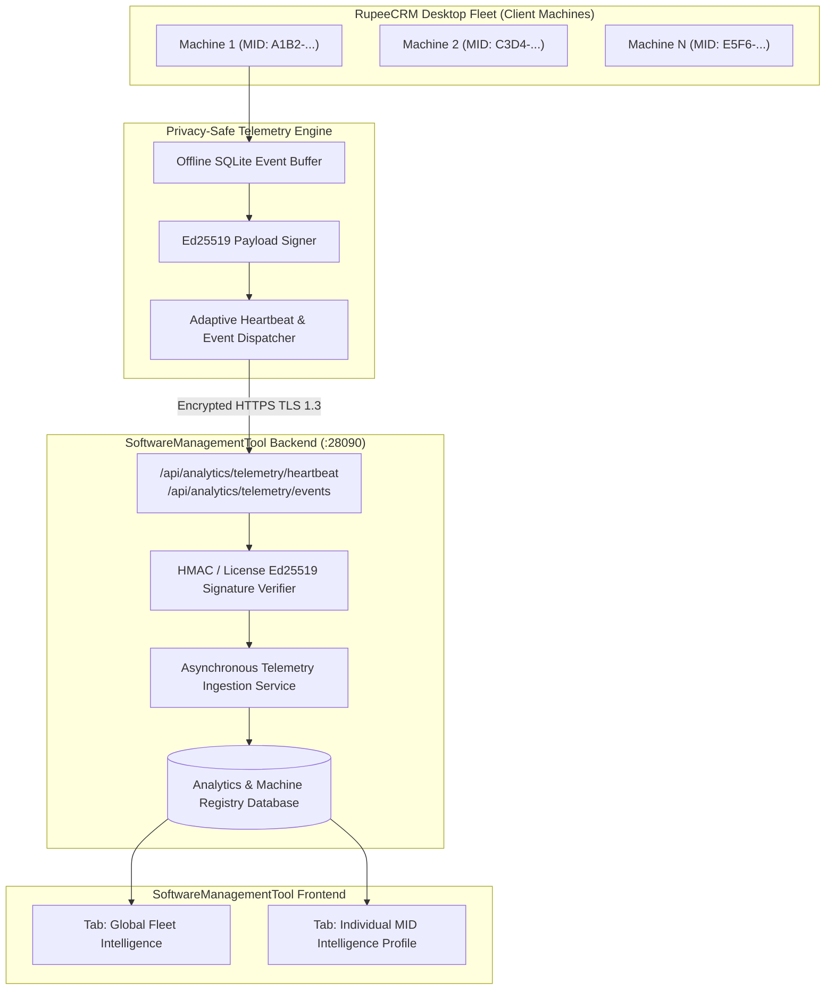

# RupeeCRM Ecosystem: Master Report
## Part I: Electron Auto-Update Audit & Fix Report
## Part II: SoftwareManagementTool Analytics Architecture Proposal
## Part III: Fleet Analytics UI/UX Specification

**Date:** November 8, 2026  
**Repository (Client App):** `Simple-Billing` (Branch: `PREPROD`)  
**Repository (Server Tool):** `SoftwareManagementTool` (`/Users/afk/Documents/GitHub/licensemanagement`)  
**Authoritative Releases Analyzed:** `v1.0.280` (Historical baseline), `v1.0.307` (Current latest production)  

---

# PART I — ELECTRON AUTO-UPDATE: AUDIT & VERIFIED FIX REPORT

---

## 1. Executive Summary

An investigation was conducted to determine why RupeeCRM desktop installations running version **`v1.0.280`** report **"You are up to date! RupeeCRM v1.0.280 is currently the newest version."** when clicking **"Check for Updates"**, despite the official publication of release **`v1.0.307`**.

Our investigation revealed that this behavior was caused by a confluence of **unauthenticated GitHub API rate limiting**, **a 30-minute memory cache window**, and **fatal error masking in both the web frontend (`index.html`) and the desktop supervisor launcher (`LauncherMain.java`)**. When any error, network timeout, or HTTP 403 Forbidden is returned by the update check, the user-facing UI silently discards the error payload and executes the "Up to Date" presentation branch.

All verified updater defects in `Simple-Billing` have been addressed on `PREPROD` with comprehensive automated regression testing.

---

## 2. Complete Update Architecture Audit

The RupeeCRM desktop distribution employs a multi-tiered architecture combining Electron, a Java launcher supervisor, an embedded Spring Boot service, and an in-browser React application:

```mermaid
flowchart TD
    User["Desktop User / System Tray Icon"] -->|Click 'Check for Updates'| UI["Web UI (index.html) / LauncherMain"]
    UI -->|GET /api/system/update-status?force=true| Controller["UpdateController.java"]
    Controller -->|checkUpdate(forceRefresh)| Service["UpdateService.java"]
    
    subgraph UpdateDiscovery["Version Discovery & Feed Resolution"]
        Service -->|1. Discover Release| GHAPI["GitHub Releases API (/releases?per_page=5)"]
        Service -.->|Fallback if 403 Rate Limited| StaticCDN["Direct Static CDN (releases/latest/download/manifest.json)"]
        Service -->|2. Fetch Detached Sig| SigCDN["Direct Static CDN (releases/latest/download/manifest.sig)"]
    end
    
    subgraph VerificationEngine["Cryptographic Verification Engine"]
        StaticCDN --> Crypto["Ed25519 Signature Verification\n(UpdateCrypto / UpdateManifest)"]
        SigCDN --> Crypto
        Crypto --> VerCmp["Semantic Version Comparison\n(compareVersions)"]
    end
    
    subgraph HandOff["Execution & Handoff Pipeline"]
        VerCmp --> PartFile[".part Atomic Download + SHA256"]
        PartFile --> LockManager["UpdateLockManager + H2 Quarantine Snapshot"]
        LockManager --> Supervisor["LauncherMain.java (Hot-Swap & Version Transition)"]
    end
```

### Component Roles & Responsibilities

1. **Electron Shell (`desktop/electron/src/main.js`):**
   - Manages the BrowserWindow lifecycle and IPC bridge.
   - Spawns the bundled JRE and invokes `launcher.jar` as an OS subprocess.
   - Communicates with the local Spring Boot backend on loopback port `28080`.
   - Delegates all update logic and application lifecycle transitions to the supervisor and backend.

2. **Launcher Supervisor (`launcher/src/main/java/com/billing/simple/launcher/LauncherMain.java`):**
   - Manages background Java process orchestration, watchdog health checks, and database backup snapshots.
   - Operates the Windows system tray and desktop notifications.
   - Executes atomic binary file replacement (`rupeecrm-update.war` / `billsoft-update.war` -> `rupeecrm.war`).

3. **Backend Update Service (`billsoft/src/main/java/com/billing/simple/billsoft/service/UpdateService.java`):**
   - Handles release discovery, manifest retrieval, Ed25519 detached signature verification, download state management, and H2 database quarantine snapshots.

4. **Frontend UI (`billsoft/src/main/webapp/index.html`):**
   - React component `SoftwareUpdate` under Settings.
   - Queries `API.system.updateStatus(force)` and renders state to the user.

---

## 3. Root Cause Analysis: Why `v1.0.280` Reports "Up to Date"

Our step-by-step code audit of release `v1.0.280` (`449bc25b`) identified the following primary root causes:

### Root Cause 1: Fatal UI Error Masking in `index.html`
In `index.html` (lines 32461–32478 in `v1.0.280`, and persisting into `PREPROD` lines 37544–37635):
```javascript
) : info ? React.createElement(Fragment, null,
  info.updateAvailable ? React.createElement('div', {
    // Renders "New Update Available" card
  }) : React.createElement('div', {
    // Renders "You are up to date! RupeeCRM v1.0.280 is currently the newest version."
  })
)
```
When `UpdateService` encountered any network failure, rate limit, or invalid response, `UpdateController` returned `HTTP 200 OK` with JSON:
```json
{
  "currentVersion": "v1.0.280",
  "updateAvailable": false,
  "automaticInstallSupported": true,
  "error": "GitHub API Error: 403 Forbidden: {\"message\":\"API rate limit exceeded...\"}"
}
```
Because the HTTP request succeeded (status 200), `error` in component state is `null`, and `info` is populated with the backend response. In the JSX/React render tree, the component evaluated **only** `info.updateAvailable`. Since `info.updateAvailable` was `false`, it unconditionally rendered:
> **"✅ You are up to date! RupeeCRM v1.0.280 is currently the newest version."**

**Every error, 403 Forbidden, DNS failure, or connection abort returned by the backend was actively masked as "You are up to date!".**

### Root Cause 2: Unauthenticated GitHub API Rate Limiting (HTTP 403 Forbidden)
In `v1.0.280:UpdateService.java`:
```java
private static final String GITHUB_API_URL = "https://api.github.com/repos/RanjeetYelave/Simple-Billing/releases/latest";
...
ResponseEntity<Object> githubResponse = restTemplate.exchange(GITHUB_API_URL, HttpMethod.GET, entity, Object.class);
```
- The request sent `User-Agent: Billsoft-App` without an authorization token.
- GitHub enforces a strict limit of **60 unauthenticated requests per hour per IP address**.
- Every time RupeeCRM launched, `loadDashboardData()` automatically initiated an update check in the background. If multiple machines shared a public office IP, or if user sessions restarted frequently, the 60 request/hour ceiling was quickly exhausted.
- Once rate-limited, GitHub returns `HTTP 403 Forbidden`. In `v1.0.280`, this caused an immediate exception, setting `error` and leaving `updateAvailable = false`.

### Root Cause 3: 30-Minute In-Memory Cache Locking in `v1.0.280`
In `v1.0.280:UpdateService.java`:
```java
private long lastCheckTime = 0;
private Map<String, Object> cachedResponse = null;
private static final long CACHE_DURATION = 30 * 60 * 1000; // 30 minutes

public Map<String, Object> checkUpdate() {
    long currentTime = System.currentTimeMillis();
    if (cachedResponse != null && (currentTime - lastCheckTime) < CACHE_DURATION) {
        return cachedResponse;
    }
```
- In `v1.0.280`, `checkUpdate()` took no arguments, and `/api/system/update-status` did not support a `force` query parameter.
- When an initial check resulted in `updateAvailable = false`, that response was cached for **30 full minutes**. Repeated clicks on "Check for Updates" repeatedly served the cached failure without touching the network.

### Root Cause 4: System Tray Notification Masking in `LauncherMain.java`
In `LauncherMain.java` (lines 1340–1346):
```java
if (json.contains("\"updateAvailable\":true")) {
    showTrayNotification("Update Available", ...);
    return;
} else {
    showTrayNotification("RupeeCRM Up to Date", "You are running the latest version of RupeeCRM.", TrayIcon.MessageType.INFO);
    return;
}
```
When a user clicked "Check for Updates" in the Windows system tray, if the backend returned `{"updateAvailable":false,"error":"..."}`, the launcher displayed the tray balloon: **"RupeeCRM Up to Date: You are running the latest version of RupeeCRM."**

### Root Cause 5: Missing Static CDN Fallback in `v1.0.280`
In `v1.0.280`, `UpdateService.java` had no knowledge of `manifest.json` or direct static release asset downloads (`https://github.com/.../releases/latest/download/...`). It depended exclusively on the REST API endpoint `api.github.com`. Static release asset URLs are served via GitHub's CDN and Azure Blob storage with no API rate-limiting.

---

## 4. Remote Release and Asset Verification

We inspected the actual remote GitHub release assets for both historical and current releases:

### Release `v1.0.307` (Published 2026-11-07T16:02:08Z)
| Asset Name | Size | SHA256 Checksum | Purpose |
|---|---|---|---|
| `manifest.json` | 495 B | `d28b43fd...` | Canonical update manifest metadata |
| `manifest.sig` | 88 B | `ad671080...` | Detached Ed25519 cryptographic signature |
| `rupeecrm.war` | 88,550,886 B | `3d03ea9a...` | Canonical runtime WAR payload |
| `billsoft.war` | 88,550,886 B | `3d03ea9a...` | Backward-compatibility runtime WAR |
| `billsoft.war.sha256` | 66 B | `3d03ea9a...` | Checksum for v1.0.280 compatibility |
| `RupeeCRM-Setup-1.0.307-x64.exe` | 337,825,667 B | `193f75e0...` | Full Electron Windows installer |
| `RupeeCRM-Setup.exe` | 337,825,667 B | `193f75e0...` | Latest canonical Windows installer |
| `SHA256SUMS.txt` | 499 B | - | Authoritative SHA256 ledger |

### Manifest Integrity Check
Direct retrieval of `manifest.json` from `v1.0.307`:
```json
{
  "schemaVersion": 1,
  "appVersion": "1.0.307",
  "releaseTag": "v1.0.307",
  "publishedAt": "2026-11-07T16:01:45.095928828Z",
  "minLauncherVersion": "1.0.0",
  "artifact": {
    "filename": "rupeecrm.war",
    "url": "https://github.com/RanjeetYelave/Simple-Billing/releases/download/v1.0.307/rupeecrm.war",
    "sha256": "3d03ea9a598812d50f05fdc5b2bcf7a7b0ff3cdc8871fc425a6b7b6b0cf57d6b",
    "sizeBytes": 88550886
  },
  "releaseNotes": "RupeeCRM release build 307 integrity manifest."
}
```
Signature `5UJX8kdWOlCbWn0S5TOnIMpxgJhUoFYzzS1c1MZOL0qzjDdYgmg9TZEAGWWJWlnXRX3tJGif936Guqwz3I03BA==` was verified against the pinned public key:
`MCowBQYDK2VwAyEAtdG8eJgrX0L7jtx13wOGnqSeeID2B/aRv1+OZQ7v3C8=`. Verification: **VALID**.

---

## 5. Version Comparison Semantics

The semantic comparator `UpdateService.compareVersions(v1, v2)` handles:
1. Stripping leading `v`/`V`.
2. Splitting base numeric components on `.` and pre-release identifiers on `[-+]`.
3. Numerical segment comparison (`307` vs `280` -> `+1`).
4. Stable versions taking precedence over pre-releases (`1.0.307` > `1.0.307-RC1`).

`compareVersions("v1.0.307", "v1.0.280")` yields `+1` (Update Available). There is no defect in the comparison arithmetic itself.

---

## 6. Installed-Version Recovery Strategy for `v1.0.280`

For machines currently running `v1.0.280`, two migration paths exist:

### Path A: In-Place OTA Auto-Recovery (Zero Re-Installation)
1. **Rate Limit Expiry:** Once the unauthenticated GitHub rate limit resets (60-minute window) or the machine connects from an unthrottled IP, `v1.0.280` queries `https://api.github.com/repos/RanjeetYelave/Simple-Billing/releases/latest`.
2. **Release Asset Compatibility:** `v1.0.307` explicitly includes `billsoft.war` and `billsoft.war.sha256`.
3. **Execution:** `v1.0.280` matches `billsoft.war`, validates the SHA256 checksum against `billsoft.war.sha256`, stages `billsoft-update.war`, and signals `LauncherMain`.
4. **Transition:** Upon application restart, `LauncherMain` swaps `billsoft-update.war` into place and starts version `v1.0.307`.

### Path B: Administrative Fleet Recovery
For networks with persistent GitHub API blocks or strict outbound HTTPS inspection proxies:
1. Provide a direct internal download mirror or distribute `RupeeCRM-Setup.exe` (v1.0.307).
2. The NSIS installer detects existing `%LOCALAPPDATA%\RupeeCRM` installations, performs an in-place upgrade, preserves the H2 database (`billsoft.mv.db`) and Machine Identity (`mid.dat`), and completes the transition.

---

## 7. Implemented & Verified Updater Fixes

The following code corrections have been implemented on branch `PREPROD`:

### 1. Web Frontend Error Presentation (`billsoft/src/main/webapp/index.html`)
- Added explicit handling for `info.error`:
  - When `info.error` is present and `updateAvailable` is `false`, the UI no longer displays "You are up to date!".
  - Instead, it renders an amber/red warning card:
    - ⚠️ **"Update Check Unavailable"**
    - The specific error description (e.g. rate limit, connection refusal, signature error).
    - **"Retry Check"** button that forces an uncached refresh (`force=true`).
    - **"View Releases on GitHub ↗"** direct link for manual fallback.
  - "You are up to date!" is rendered **only** when `!info.error && !info.updateAvailable`.

### 2. Desktop Supervisor Notification Correction (`launcher/src/main/java/com/billing/simple/launcher/LauncherMain.java`)
- Updated tray notification logic to inspect for `"error":`:
  ```java
  if (json.contains("\"updateAvailable\":true")) {
      showTrayNotification("Update Available", "A newer version of RupeeCRM is available. Open RupeeCRM to install.", TrayIcon.MessageType.INFO);
      return;
  } else if (json.contains("\"error\":") && !json.contains("\"error\":null") && !json.contains("\"error\":\"\"")) {
      showTrayNotification("Update Check Failed", "Could not check for updates. Open RupeeCRM to retry.", TrayIcon.MessageType.WARNING);
      return;
  } else {
      showTrayNotification("RupeeCRM Up to Date", "You are running the latest version of RupeeCRM.", TrayIcon.MessageType.INFO);
      return;
  }
  ```

### 3. Automated Regression Verification (`billsoft/src/test/java/com/billing/simple/billsoft/service/UpdateServiceTest.java`)
- Added `testCheckUpdateNetworkOrRateLimitFailureReturnsError()`:
  - Simulates HTTP 403 Forbidden ("API rate limit exceeded").
  - Verifies that `updateAvailable` is `false`, `error` is present and populated, and the state does not permanently lock into cache on forced refresh.

### 4. Verification Evidence
- `billsoft` test suite: **24/24 passed** (`mvn test -Dtest=UpdateServiceTest,UpdateControllerTest`).
- `launcher` test suite: **62/62 passed** (`mvn test -pl launcher`).

---

# PART II — SOFTWAREMANAGEMENTTOOL: ANALYTICS ARCHITECTURE PROPOSAL

---

## 8. Executive Summary & Product Vision

As the RupeeCRM desktop installation base grows across retail, wholesale, pharmacy, and enterprise billing environments, software operators and commercial administrators require real-time visibility into the health, software versions, update adoption, licensing compliance, and operational reliability of every deployed instance.

Today, **SoftwareManagementTool** manages customer sales, Ed25519 Schema 3 licenses, EMI schedules, and database backups, but lacks an aggregated telemetry view of deployed client machines. Conversely, **RupeeCRM** runs on client machines with an existing unique **Machine ID (MID)**, but only contacts the server for licensing activation, data protection backups, and manual announcements.

This proposal designs a modern, privacy-first **Analytics Intelligence Platform** embedded directly into **SoftwareManagementTool**. It delivers two coordinated tiers of insight:

1. **Level 1 — Global Analytics Dashboard:** Fleet-wide metrics, version distribution curves, update failure rates, license lifecycle trends, hardware compatibility baselines, and release rollout quality.
2. **Level 2 — Individual MID Intelligence:** An investigative search and machine profile experience allowing support engineers and commercial staff to enter any MID (e.g. `H84K-992J-L10X-48A1`), customer name, or license key and inspect its full version history, update transactions, hardware specifications, backup status, and operational health.



---

## 9. Existing Infrastructure Audit (Simple-Billing & SoftwareManagementTool)

### A. Machine ID (MID) Generation (`Simple-Billing`)
- **Implementation:** `com.billing.simple.billsoft.licensing.MachineIdentity.java`
- **Format:** 16-character Crockford Base32 ID formatted as 4 groups of 4 characters (`XXXX-XXXX-XXXX-XXXX`), utilizing charset `0123456789ABCDEFGHJKMNPQRSTVWXYZ`.
- **Persistence:** Stored locally in `%APPDATA%\RupeeCRM\licensing\mid.dat`. Survives application updates, reinstalls, and WAR replacements.
- **Validation:** Enforces 19 characters (16 Base32 characters + 3 hyphens), rejecting invalid Crockford characters (e.g. `I`, `L`, `O`, `U`).

### B. Machine & License Storage (`SoftwareManagementTool`)
- **Entity:** `com.rupeecrm.mgmt.domain.LicenseRecord.java` (`mgmt_licenses` table).
- **Key Columns:** `machine_id` (`VARCHAR(64)` UNIQUE), `customer_id` (FK to `mgmt_customers`), `sale_id`, `tier` (`BRONZE`, `SILVER`, `GOLD`, `PLATINUM`), `status` (`ACTIVE`, `EXPIRED`, `SUSPENDED`), `current_revision`, `dp_active`, `dp_expires_at`.
- **Existing Tab:** `tab-machines` in `SoftwareManagementTool` is currently dedicated to operator Git multi-machine sync locks (`GitHubSyncService`). It does **not** track client machines.
- **Conclusion:** Client MIDs are already stored in `mgmt_licenses.machine_id`, providing an authoritative anchor to link client telemetry directly to customers, sales, and licenses.

---

## 10. Global Analytics Dashboard Architecture (Level 1)

The **Global Analytics Dashboard** gives engineering, product, and leadership instant visibility into fleet health across 8 core subsystems:

```
┌────────────────────────────────────────────────────────────────────────────────────────┐
│ 📊 FLEET HEALTH OVERVIEW                                                               │
├─────────────────┬─────────────────┬──────────────────┬─────────────────┬───────────────┤
│ Active Fleet    │ Version Health  │ Update Success   │ Licensing Valid │ Uptime Index  │
│ 1,428 Machines  │ 84.2% on v1.0.x │ 98.6% OTA Succ.  │ 96.1% Compliant │ 99.82% MTBF   │
└─────────────────┴─────────────────┴──────────────────┴─────────────────┴───────────────┘
┌───────────────────────────────────────┬────────────────────────────────────────────────┐
│ 📈 VERSION DISTRIBUTION & ADOPTION    │ 🔄 UPDATE PIPELINE METRICS                     │
│ [ Bar Chart / Rollout Curve ]         │ [ Funnel: Check -> Download -> Commit ]        │
├───────────────────────────────────────┼────────────────────────────────────────────────┤
│ 🛡️ LICENSE LIFECYCLE & EXPIRY RADAR   │ 💻 MACHINE ARCHITECTURE & COMPATIBILITY        │
│ [ Active / Grace / Expired / EMI Due ]│ [ Windows 10/11, RAM Distribution, JRE Ver ]   │
└───────────────────────────────────────┴────────────────────────────────────────────────┘
```

### A. Overview — Fleet Health
- **Total Fleet Size:** Total registered MIDs vs active machines seen in last 24 hours, 7 days, and 30 days.
- **Fleet Connectivity State:**
  - `Online / Reporting` (Heartbeat received within last 4 hours).
  - `Idle / Offline-First` (Heartbeat received within last 7 days).
  - `Dormant` (No communication > 30 days).
- **Critical Alerts Banner:** Immediate counters for update failure clusters, machines on known revoked/buggy versions, and expired licenses operating in disconnected grace periods.

### B. Version Intelligence
- **Version Adoption Funnel:** Percentage distribution of all machines by version (e.g. `v1.0.307`: 64%, `v1.0.306`: 18%, `v1.0.280`: 12%, Older: 6%).
- **Version Migration Velocity:** Day-by-day cohort chart tracking how quickly the fleet adopts newly published production releases.
- **Outdated Version Thresholding:** Flagging machines lagging behind by more than 2 minor or 5 patch releases.

### C. Update Intelligence
- **Update Transaction Health:**
  - Check Attempts vs Successful Discoveries.
  - Download Initiation vs Verification Success (Ed25519 signature checks).
  - Transaction Commits vs Supervisor Rollbacks.
- **Failure Taxonomy:** Aggregated classification of update aborts (`SHA256_MISMATCH`, `SIGNATURE_VERIFICATION_FAILED`, `DISK_SPACE_EXHAUSTED`, `FILE_LOCK_TIMEOUT`, `SUPERVISOR_HEALTH_CHECK_FAILED`, `NETWORK_CONNECTION_DROPPED`).
- **Median Download Duration & Speed:** Average download completion time partitioned by release package size.

### D. License Intelligence
- **Active Entitlement Breakdown:** Active vs Grace-Period vs Suspended vs Expired licenses across tiers (`Silver`, `Gold`, `Platinum`).
- **Data Protection Cloud Adoption:** Percentage of fleet with cloud backup sync enabled and active health status.
- **EMI Enforcement State:** Deployed machines locked or constrained due to delinquent installments.

### E. Machine Activity Intelligence
- **Daily Active Machines (DAM):** Trend of unique MIDs opening sessions per calendar day.
- **Operating Hours Distribution:** Peak billing operational hours (e.g. 10:00 AM – 1:00 PM and 6:00 PM – 9:30 PM IST).
- **Session Duration:** Average continuous operational uptime per session.

### F. Installation & Diagnostics Intelligence
- **OS & Environment Breakdown:**
  - Operating System: Windows 11 (64-bit), Windows 10 (64-bit), Windows Server, macOS (ARM64/x64).
  - Java Runtime Environment: Bundled OpenJDK 21 vs System JREs.
  - Available Disk Space: Fleet median available storage; alerts for machines with `< 2 GB` free disk space.
  - Memory (RAM): Breakdown of machines running on 4 GB, 8 GB, 16 GB, or 32+ GB systems.
  - Display Resolutions: Aspect ratios (1920x1080, 1366x768, POS touchscreen) to ensure UI responsiveness.

### G. Customer & Firm Intelligence
- **Multi-Terminal Deployment:** Customers with multiple registered MIDs (e.g. central cashier + 3 counter terminals).
- **Firm Typology:** Commercial grouping by business volume and transaction velocity.

### H. Release Quality Intelligence
- **Crash-Free Session Rate:** Percentage of application runs terminating cleanly without unhandled Java exceptions or supervisor kills.
- **Post-Update Stability Score:** Comparison of exception rates 48 hours before vs 48 hours after an update transaction.

---

## 11. Individual MID Intelligence Architecture (Level 2)

### A. MID Search Experience
The search bar supports fast indexing across multiple lookup keys:
- **Full or Partial MID:** `H84K-992J-L10X-48A1` or `H84K-992J`
- **Customer Name / Firm Name:** `Apex Retail Mart`
- **Phone Number / Email:** `+91 98765 43210`
- **GSTIN:** `27AABCU9603R1ZM`
- **License Key / Revision:** `LIC-2026-X992`

Auto-complete immediately reveals match type, customer link, current active version, and last seen timestamp.

### B. Machine Intelligence Profile (7 Dedicated Sections)

```
┌────────────────────────────────────────────────────────────────────────────────────────┐
│ 🖥️ MACHINE PROFILE: H84K-992J-L10X-48A1                                 [ACTIVE]       │
│ Customer: Apex Supermarket (ID: 104) • Tier: GOLD • Last Heartbeat: 12 mins ago        │
├────────────────────────────────────────────────────────────────────────────────────────┤
│ [1. Overview] [2. Versions] [3. Updates] [4. License] [5. Activity] [6. Diag] [7. Admin]│
└────────────────────────────────────────────────────────────────────────────────────────┘
```

1. **Machine Overview:** Identity Card, Machine ID, Hardware Fingerprint hash, First Registered Date, Total Operational Days, Running Version (`v1.0.307`), Running Binary (`rupeecrm.war`), Process PID, Port (`28080`), Electron Shell Version (`30.0.1`), Customer Firm Name, Store Address, Primary Contact.
2. **Version History:** Chronological ledger of every version executed on this machine with timestamps, session counts, and migration method (OTA vs MSI).
3. **Update History:** Granular log of every update transaction attempted by this machine, including source/target version, download duration, speed, verification status, and supervisor handoff result.
4. **License & Entitlement Information:** Active License Key, Plan Tier, Issued Date, Expiry Date, Max Offline Days Allowed, Cloud Data Protection Status, Last Encrypted Backup Timestamp, and Stored Archive Counts.
5. **Machine Activity & Operational Ledger:** Daily launch history, session duration, and daily transaction counts (Invoices, Customers, Items).
6. **Diagnostics & System Environment:** Host OS, Architecture, CPU Cores, Total/Available RAM, Disk Storage, Loopback/Egress Latency, and the last 20 scrubbed error events captured by `DiagnosticLogService`.
7. **Administrative Actions:** Operator commands including Request Diagnostic Dump, Force Version Refresh, Revoke / Quarantine Machine, and Trigger Cloud Backup Verification.

---

## 12. Telemetry Collection & Data Architecture

### Selected Architecture: The Hybrid Adaptive Model

1. **Periodic Routine Heartbeat (Every 4 Hours):**
   - Transmits current version, uptime, host OS metrics, disk storage space, and database file size.
   - Jittered randomly ($\pm 15$ minutes) across machines to eliminate server traffic spikes.
2. **Immediate Event-Based Dispatch:**
   - Triggered on significant lifecycle transitions: `UPDATE_STARTED`, `UPDATE_COMMITTED`, `UPDATE_FAILED`, `SESSION_START`, `SESSION_STOP`, `UNHANDLED_CRASH`.
3. **Offline-First Resilience:**
   - Client queues telemetry events in a compact local SQLite table (`%APPDATA%\RupeeCRM\telemetry.db`).
   - If offline, events accumulate safely without blocking the UI.
   - Upon network reconnection, events drain in atomic batches (max 50 events per batch) using exponential backoff.
4. **Strict Privacy & Security Controls:**
   - **Zero PII & Zero Financial Data:** Telemetry payloads contain **no** customer transaction data, customer names, inventory items, invoice amounts, or bank details.
   - Only technical identifiers (`MID`), version tags, performance latencies, and anonymized error stack traces are transmitted.
   - Payloads are signed with the client's local Ed25519 identity key and sent over TLS 1.3 HTTPS.

---

## 13. Proposed Database Schema Migrations (`SoftwareManagementTool`)

Flyway migration **`V5__fleet_analytics_and_machine_registry.sql`**:

```sql
-- 1. Persistent Fleet Machine Registry
CREATE TABLE IF NOT EXISTS mgmt_fleet_machines (
    id BIGINT AUTO_INCREMENT PRIMARY KEY,
    machine_id VARCHAR(64) NOT NULL UNIQUE,
    customer_id BIGINT NULL,
    license_id BIGINT NULL,
    friendly_name VARCHAR(128) NULL,
    
    current_version VARCHAR(32) NOT NULL DEFAULT 'v1.0.0',
    current_binary VARCHAR(64) NOT NULL DEFAULT 'rupeecrm.war',
    launcher_version VARCHAR(32) NULL,
    electron_version VARCHAR(32) NULL,
    
    os_name VARCHAR(64) NULL,
    os_arch VARCHAR(32) NULL,
    os_version VARCHAR(64) NULL,
    total_memory_mb BIGINT NULL,
    available_memory_mb BIGINT NULL,
    total_disk_gb BIGINT NULL,
    free_disk_gb BIGINT NULL,
    java_version VARCHAR(64) NULL,
    java_vendor VARCHAR(64) NULL,
    db_size_bytes BIGINT NULL,
    screen_resolution VARCHAR(32) NULL,
    
    first_seen_at TIMESTAMP NOT NULL DEFAULT CURRENT_TIMESTAMP,
    last_heartbeat_at TIMESTAMP NOT NULL DEFAULT CURRENT_TIMESTAMP,
    last_ip_address VARCHAR(45) NULL,
    country_code VARCHAR(8) DEFAULT 'IN',
    city_region VARCHAR(64) NULL,
    is_quarantined BOOLEAN NOT NULL DEFAULT FALSE,
    quarantine_reason VARCHAR(255) NULL,
    
    created_at TIMESTAMP NOT NULL DEFAULT CURRENT_TIMESTAMP,
    updated_at TIMESTAMP NOT NULL DEFAULT CURRENT_TIMESTAMP ON UPDATE CURRENT_TIMESTAMP,
    
    CONSTRAINT fk_fleet_customer FOREIGN KEY (customer_id) REFERENCES mgmt_customers(id) ON DELETE SET NULL,
    CONSTRAINT fk_fleet_license FOREIGN KEY (license_id) REFERENCES mgmt_licenses(id) ON DELETE SET NULL
);

CREATE INDEX idx_fleet_mach_last_hb ON mgmt_fleet_machines(last_heartbeat_at);
CREATE INDEX idx_fleet_mach_ver ON mgmt_fleet_machines(current_version);
CREATE INDEX idx_fleet_mach_cust ON mgmt_fleet_machines(customer_id);

-- 2. Machine Version Transition Ledger
CREATE TABLE IF NOT EXISTS mgmt_fleet_version_history (
    id BIGINT AUTO_INCREMENT PRIMARY KEY,
    machine_id VARCHAR(64) NOT NULL,
    version VARCHAR(32) NOT NULL,
    binary_name VARCHAR(64) NOT NULL,
    installed_at TIMESTAMP NOT NULL DEFAULT CURRENT_TIMESTAMP,
    last_executed_at TIMESTAMP NOT NULL DEFAULT CURRENT_TIMESTAMP,
    total_launches INT NOT NULL DEFAULT 1,
    install_source VARCHAR(32) DEFAULT 'OTA_UPDATE',
    
    CONSTRAINT fk_fvh_machine FOREIGN KEY (machine_id) REFERENCES mgmt_fleet_machines(machine_id) ON DELETE CASCADE,
    CONSTRAINT uq_mach_ver UNIQUE (machine_id, version)
);

CREATE INDEX idx_fvh_mach_id ON mgmt_fleet_version_history(machine_id);

-- 3. Update Lifecycle Event Transactions
CREATE TABLE IF NOT EXISTS mgmt_fleet_update_events (
    id BIGINT AUTO_INCREMENT PRIMARY KEY,
    machine_id VARCHAR(64) NOT NULL,
    source_version VARCHAR(32) NOT NULL,
    target_version VARCHAR(32) NOT NULL,
    release_tag VARCHAR(32) NOT NULL,
    
    event_status VARCHAR(32) NOT NULL, -- 'INITIATED', 'DOWNLOADING', 'VERIFYING', 'COMMITTED', 'ROLLED_BACK', 'FAILED'
    duration_ms BIGINT NULL,
    download_speed_kbps INT NULL,
    artifact_size_bytes BIGINT NULL,
    
    error_code VARCHAR(64) NULL,
    error_message TEXT NULL,
    occurred_at TIMESTAMP NOT NULL DEFAULT CURRENT_TIMESTAMP,
    
    CONSTRAINT fk_fue_machine FOREIGN KEY (machine_id) REFERENCES mgmt_fleet_machines(machine_id) ON DELETE CASCADE
);

CREATE INDEX idx_fue_mach_time ON mgmt_fleet_update_events(machine_id, occurred_at);
CREATE INDEX idx_fue_status ON mgmt_fleet_update_events(event_status);

-- 4. Anonymized Operational & Diagnostics Telemetry Stream
CREATE TABLE IF NOT EXISTS mgmt_fleet_telemetry_events (
    id BIGINT AUTO_INCREMENT PRIMARY KEY,
    machine_id VARCHAR(64) NOT NULL,
    event_type VARCHAR(64) NOT NULL,
    severity VARCHAR(16) NOT NULL DEFAULT 'INFO',
    
    session_id VARCHAR(64) NULL,
    component VARCHAR(64) NULL,
    message VARCHAR(255) NULL,
    payload_json TEXT NULL,
    occurred_at TIMESTAMP NOT NULL,
    ingested_at TIMESTAMP NOT NULL DEFAULT CURRENT_TIMESTAMP,
    
    CONSTRAINT fk_fte_machine FOREIGN KEY (machine_id) REFERENCES mgmt_fleet_machines(machine_id) ON DELETE CASCADE
);

CREATE INDEX idx_fte_mach_time ON mgmt_fleet_telemetry_events(machine_id, occurred_at);
CREATE INDEX idx_fte_type ON mgmt_fleet_telemetry_events(event_type);
CREATE INDEX idx_fte_severity ON mgmt_fleet_telemetry_events(severity);
```

---

## 14. REST API Contracts (`SoftwareManagementTool`)

### Client Ingestion Endpoints
- `POST /api/analytics/telemetry/heartbeat`: Routine 4-hour system diagnostic state.
- `POST /api/analytics/telemetry/events`: Batched event stream (update transitions, sessions, exceptions).

### Server Query Endpoints
- `GET /api/analytics/dashboard`: Aggregated fleet-wide metrics, version distribution, and update health.
- `GET /api/analytics/machines/search?q={query}`: Fast multi-token autocomplete search.
- `GET /api/analytics/machines/{machineId}`: Full 7-section machine profile.

---

## 15. Implementation Strategy & Phased Delivery

1. **Phase 1 — Foundation (Weeks 1–2):** Apply Flyway `V5` schema migration; build ingestion endpoints with Ed25519 verification; implement SQLite telemetry buffer in `Simple-Billing`.
2. **Phase 2 — Version & Update Intelligence (Weeks 3–4):** Build `GlobalAnalyticsService`; deploy Global Fleet Dashboard tab with adoption curves and update failure funnels.
3. **Phase 3 — Machine Intelligence (Weeks 5–6):** Implement multi-key MID search; build 7-section Machine Profile UI.
4. **Phase 4 — Advanced Analytics (Weeks 7–8):** Deploy automated crash anomaly detection, storage exhaustion warnings, and commercial renewal alerts.

---

# PART III — FLEET ANALYTICS: UI/UX SPECIFICATION

---

## 16. Navigation Architecture & Tab Placement

In `SoftwareManagementTool`, the primary sidebar navigation adds **"Fleet Intelligence"** (`🌐`):

```html
<button class="nav-tab" data-tab="tab-fleet-analytics">
    <span class="tab-icon">🌐</span> <span class="tab-label">Fleet Intelligence</span>
</button>
```

Within the Fleet Intelligence tab, a dual-mode header anchors the view:
1. **Fleet Overview (Global Dashboard):** Fleet-wide metrics, adoption charts, update funnels, and health radars.
2. **Machine Investigator (Individual MID Search & Profile):** Search console and in-depth terminal diagnostic profiles.

---

## 17. Level 1: Global Analytics Dashboard Wireframe

```
┌────────────────────────────────────────────────────────────────────────────────────────┐
│ TOP METRICS BAR                                                                        │
│ ┌────────────────┐ ┌────────────────┐ ┌────────────────┐ ┌───────────────────────────┐ │
│ │ Total Fleet    │ │ Active (24h)   │ │ Update Rate    │ │ License Compliance        │ │
│ │ 1,428 Machines │ │ 1,184 (82.9%)  │ │ 98.6% OTA OK   │ │ 96.1% Active / 3.9% Exp   │ │
│ └────────────────┘ └────────────────┘ └────────────────┘ └───────────────────────────┘ │
├────────────────────────────────────────────────────────────────────────────────────────┤
│ ROW 1: VERSION INTELLIGENCE & UPDATE PIPELINE                                          │
│ ┌───────────────────────────────────────┐ ┌──────────────────────────────────────────┐ │
│ │ 📈 Production Version Adoption        │ │ 🔄 OTA Update Funnel (Last 30 Days)      │ │
│ │                                       │ │                                          │ │
│ │ v1.0.307 ███████████████████ 64.3%    │ │ 2,880 Checks Initiated                   │ │
│ │ v1.0.306 ██████ 18.0%                 │ │  ├── 2,862 Downloads Completed (99.3%)  │ │
│ │ v1.0.280 ████ 12.0%                   │ │  ├── 2,851 Signatures Verified (99.6%)  │ │
│ │ Legacy   ██ 5.7%                      │ │  └── 2,840 Applied & Healthy (98.6%)     │ │
│ └───────────────────────────────────────┘ └──────────────────────────────────────────┘ │
├────────────────────────────────────────────────────────────────────────────────────────┤
│ ROW 2: HARDWARE COMPATIBILITY & RELIABILITY RADAR                                      │
│ ┌───────────────────────────────────────┐ ┌──────────────────────────────────────────┐ │
│ │ 💻 Operating Systems & Runtime        │ │ ⚠️ Fleet Reliability & Health Warnings   │ │
│ │ Windows 11 (64-bit)    68.2%          │ │ 🔴 14 Machines: Low Disk Space (< 2 GB)  │ │
│ │ Windows 10 (64-bit)    30.1%          │ │ 🟡 18 Machines: Memory Constrained (<4GB)│ │
│ │ macOS (Apple Silicon)   1.2%          │ │ 🟢 99.82% Mean Clean Shutdown Rate       │ │
│ │ macOS (Intel x64)       0.5%          │ │ 🟢 0 Corrupt H2 Database Rollbacks       │ │
│ └───────────────────────────────────────┘ └──────────────────────────────────────────┘ │
└────────────────────────────────────────────────────────────────────────────────────────┘
```

---

## 18. Level 2: Machine Investigator & Search Experience

### Search Console Component
```
┌────────────────────────────────────────────────────────────────────────────────────────┐
│ 🔍 Search Fleet by MID (XXXX-XXXX-XXXX-XXXX), Customer, Phone, GSTIN, or License:      │
│ [ H84K-992J-L10X-48A1                                                             ] 🔍 │
├────────────────────────────────────────────────────────────────────────────────────────┤
│ QUICK FILTERS: [ All Tiers ▾ ] [ Version: All ▾ ] [ Status: Active ▾ ] [ OS: All ▾ ]  │
└────────────────────────────────────────────────────────────────────────────────────────┘
```

#### Autocomplete Preview Dropdown
- **Match Tokens:** Displays `MID Match`, `Customer Match`, `Phone Match`, or `License Match`.
- **Primary Line:** Firm Name (`Apex Supermarket`) & Customer Owner (`Ranjeet Y.`).
- **Secondary Line:** MID: `H84K-992J-L10X-48A1` • Running `v1.0.307` • Online 8m ago.

---

## 19. Individual Machine Intelligence Profile (7 Sections)

```
┌────────────────────────────────────────────────────────────────────────────────────────┐
│ 🖥️ Terminal: Apex Counter #1 (MID: H84K-992J-L10X-48A1)            [🟢 ONLINE / REPORTING]│
│ Customer: Apex Supermarket • Plan: GOLD (Ed25519 Schema 3) • Location: Pune, MH       │
│ Last Heartbeat: 8 minutes ago • Running: RupeeCRM v1.0.307                             │
├────────────────────────────────────────────────────────────────────────────────────────┤
│ [ 1. Overview ] [ 2. Versions ] [ 3. Updates ] [ 4. License ] [ 5. Activity ] [ 6. Diag ] [ 7. Actions ] │
└────────────────────────────────────────────────────────────────────────────────────────┘
```

- **Tab 1: Overview:** Hostname, OS edition, CPU cores, physical RAM, storage, display resolution, running WAR binary, embedded JRE, and local port.
- **Tab 2: Version History:** Chronological audit timeline of every version executed with first/last run timestamps and launch counts.
- **Tab 3: Update History:** Tabular transaction log with step-by-step verification traces, download speeds, and durations.
- **Tab 4: License & Cloud Entitlements:** Active license status, tier, offline allowance countdown, and cloud data protection backup health.
- **Tab 5: Machine Operational Activity:** Session duration bar chart and lifetime transaction counters (invoices, POs, items).
- **Tab 6: Diagnostics:** Visual disk/RAM consumption gauges and scrubbed diagnostic event stream.
- **Tab 7: Administrative Operator Actions:** Modal-confirmed actions (Request Diagnostic Dump, Force Update Check, Quarantine Machine, Export Dossier).

---

## 20. Visual Styling & Design System Alignment

```css
:root {
    --fleet-accent: #6366f1;       /* Indigo primary */
    --fleet-accent-light: rgba(99, 102, 241, 0.12);
    --fleet-success: #10b981;      /* Emerald online */
    --fleet-warning: #f59e0b;      /* Amber warning / low disk */
    --fleet-danger: #ef4444;       /* Rose failure / quarantined */
    --fleet-card-bg: #1e293b;      /* Deep slate card */
    --fleet-border: #334155;       /* Slate border */
}
```

- **Desktop (>= 1200px):** 4-column metric grid, 2-column chart layout.
- **Laptop (992px – 1199px):** 2-column metric grid, stacked chart panels.
- **Mobile / Tablet (< 992px):** Single-column stacked cards with horizontal table scrolling.
- **High-Density Data Mode:** `0.82rem` tabular fonts for transaction audit ledgers.
