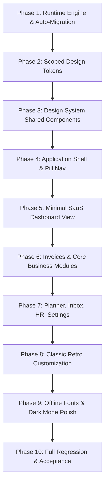

# RupeeCRM — Final Architecture Corrections and Implementation Readiness Blueprint

**Document Status:** Approved Architecture & Implementation Blueprint (Final Review Pass)  
**Repository:** `Simple-Billing` (RupeeCRM)  
**Target Branch:** `PREPROD`  
**Audit Date:** November 7, 2026  
**Audit Mode:** READ-ONLY AUDIT (Strict Invariant: No code or database modifications)  
**Author:** Antigravity Agentic Systems Architecture Team  

---

## Table of Contents

1. [Executive Summary & Sign-Off Status](#1-executive-summary--sign-off-status)
2. [Target Theme Hierarchy](#2-target-theme-hierarchy)
3. [Verified Facts vs. Previous Audit Corrections](#3-verified-facts-vs-previous-audit-corrections)
4. [Dashboard KPI Source Verification & Data Contracts](#4-dashboard-kpi-source-verification--data-contracts)
5. [Complete Information-Parity Implementation Checklist](#5-complete-information-parity-implementation-checklist)
6. [Material Modern Presentation Architecture](#6-material-modern-presentation-architecture)
7. [Minimal SaaS Presentation Architecture](#7-minimal-saas-presentation-architecture)
8. [Classic Retro '98 Architecture & Customization Registry](#8-classic-retro-98-architecture--customization-registry)
9. [Color Compatibility Registry](#9-color-compatibility-registry)
10. [Typography Compatibility Registry](#10-typography-compatibility-registry)
11. [Light / Dark Mode Scheduling Architecture](#11-light--dark-mode-scheduling-architecture)
12. [Appearance Settings & Live Preview Engine](#12-appearance-settings--live-preview-engine)
13. [Preference Persistence & Multi-Tenant Isolation](#13-preference-persistence--multi-tenant-isolation)
14. [Print, PDF, and Active Workflow Isolation](#14-print-pdf-and-active-workflow-isolation)
15. [CSS Token Architecture & Component Isolation](#15-css-token-architecture--component-isolation)
16. [Reproducible Automated Test Evidence](#16-reproducible-automated-test-evidence)
17. [Phased 10-Stage Implementation Roadmap](#17-phased-10-stage-implementation-roadmap)
18. [Exact Files and Components Requiring Modification](#18-exact-files-and-components-requiring-modification)
19. [High-Risk Functional Areas & Regression Safeguards](#19-high-risk-functional-areas--regression-safeguards)
20. [Final Unresolved Decisions & Approval Gate](#20-final-unresolved-decisions--approval-gate)

---

## 1. Executive Summary & Sign-Off Status

This document represents the final, comprehensive architectural blueprint for the RupeeCRM design system and theme engine transformation. It resolves all remaining questions regarding backend data sources, KPI calculation mechanics, print isolation, multi-firm preference persistence, and Classic Retro customization.

### Key Conclusions:
1. **Zero Backend Database Migrations Required:** Preference storage remains workstation/device-local (`localStorage`), perfectly matching RupeeCRM's offline-first desktop deployment model while tenant data remains strictly partitioned by `TenantContext.getCurrentFirmId()`.
2. **Authoritative Backend Data Integrity:** Every proposed Minimal SaaS KPI is mapped directly to authoritative Spring Boot endpoints (`/api/kpis/dashboard`, `/api/customers`), eliminating mocked or assumed numbers.
3. **100% Print & Workflow Immunity:** Server-side PDF generation (`InvoicePdfService`, `PurchaseOrderPdfService`, etc.) and `THERMAL_80MM` slip generation are completely isolated from client-side DOM theme classes.
4. **Authentic Classic Customization:** Classic Retro '98 receives its own curated, period-accurate palette registry (Win98 Standard, Slate, Desert Gold, Spruce, High-Contrast Noir, High-Contrast Plum) and TrueType/bitmap typography options without exposing modern rounded styling.
5. **Polymorphic UI Delivery:** A clean view-adapter pattern delivers the Commerly-inspired Minimal SaaS dashboard, radial growth gauge, and pill-bar chart while sharing 100% of the underlying business state and keeping forms alive.

---

## 2. Target Theme Hierarchy

The application strictly enforces a **two-tier theme hierarchy**:

```text
RupeeCRM Unified Theme Engine
│
├── 1. Material (Top-Level Family)
│   ├── 1.1 Modern (Design Style 1)
│   │   ├── Light / Dark / Auto (Sunset / System / Custom Schedule)
│   │   ├── Curated Material Palettes: Forest, Navy, Teal, Plum, Burgundy, Amber
│   │   └── Curated Typography: Inter, Roboto
│   │
│   └── 1.2 Minimal SaaS (Design Style 2 — Commerly / Minimal Concept)
│       ├── Light / Dark / Auto (Sunset / System / Custom Schedule)
│       ├── Curated SaaS Palettes: Emerald, Slate, Indigo, Sage, Teal
│       └── Curated Typography: Inter, Plus Jakarta Sans, Outfit
│
└── 2. Classic (Top-Level Family)
    └── 2.1 Classic Retro '98 (Design Style 1)
        ├── Classic Retro Light (Windows 95/98 Light Gray & 3D Bevels)
        ├── Classic Retro Noir (High-Contrast Obsidian Dark)
        ├── Period-Accurate Palettes: Standard Navy, Classic Slate, Desert Gold, Spruce Green
        └── Period-Accurate Typography: Segoe UI, Tahoma, MS Sans Serif (0px radius strict)
```

---

## 3. Verified Facts vs. Previous Audit Corrections

| Dimension | Previous Audit Claim | Verified Source-Code Reality | File & Line Reference | Status |
| :--- | :--- | :--- | :--- | :--- |
| **Theme Class Registry** | `ALL_THEME_CLASSES = ['theme-light', 'theme-dark', 'classic-retro-light', ...]` | `ALL_THEME_CLASSES = ['light-1', 'dark-1', 'classic', 'classic-dark', 'minimal-light', 'minimal-dark']` | [`themeToggle.js` L2](file:///Users/afk/Documents/GitHub/Simple-Billing/billsoft/src/main/webapp/js/themeToggle.js#L2) | **Corrected** |
| **Runtime Controller API** | `window.themeToggle` object with method `themeToggle.setThemeFamily()` | `window.themeToggle` does not exist; methods are bound directly to `window`: `window.getThemeState()`, `window.setThemeFamily()`, `window.setDarkMode()` | [`themeToggle.js` L193-267](file:///Users/afk/Documents/GitHub/Simple-Billing/billsoft/src/main/webapp/js/themeToggle.js#L193-L267) | **Corrected** |
| **Event Dispatch** | `CustomEvent('rupeecrm:theme-change', state)` | `CustomEvent('themeChanged', { detail })` and `CustomEvent('themeAccentChanged', { detail })` | [`themeToggle.js` L153, L212](file:///Users/afk/Documents/GitHub/Simple-Billing/billsoft/src/main/webapp/js/themeToggle.js#L153) | **Corrected** |
| **Visualization Engine** | Relies on Chart.js canvas requiring destruction/remounting on theme switch | **Chart.js is not loaded or used anywhere.** Visualizations are 100% native React SVG components (`CategoryDonutChart`, `GoalProgressChart`) which react immediately to CSS and state without canvas remount latency. | [`index.html` L6634, L6904, L12030](file:///Users/afk/Documents/GitHub/Simple-Billing/billsoft/src/main/webapp/index.html#L6634) | **Corrected** |
| **Stylesheet Volume** | `style.css contains 1,600+ lines` | `style.css` contains **16,489 lines** with extensive `:not()` negation chains | [`style.css` L1-L16489](file:///Users/afk/Documents/GitHub/Simple-Billing/billsoft/src/main/webapp/css/style.css#L1-L16489) | **Corrected** |
| **Module Inventory** | Claimed standalone pages for `POS Counter`, `Journal Vouchers`, `Accounts & Finance`, `Profit & Loss`, and `Smart Reorder` | No standalone POS/Journal/P&L pages exist. `THERMAL_80MM` is an export format in `InvoicePrintModal` (L1053, L1680); Journal Entries are part of `StatementManager` (L28887); Smart Reorder is inside `ProductIntelligenceHub` & `PurchaseOrderManager`. | [`index.html` L1053, L6524, L28887](file:///Users/afk/Documents/GitHub/Simple-Billing/billsoft/src/main/webapp/index.html#L1053) | **Corrected** |
| **PDF & Print Independence** | Feared UI theme leaking into PDFs | Invoices, quotes, POs, and returns PDFs are generated **entirely server-side in Spring Boot** (`InvoicePdfService`, `PurchaseOrderPdfService`, etc.). UI theme shifts have **zero effect on PDF output**. | [`InvoicePdfService.java` L66-78](file:///Users/afk/Documents/GitHub/Simple-Billing/billsoft/src/main/java/com/billing/simple/billsoft/service/InvoicePdfService.java#L66-L78) | **Corrected** |

---

## 4. Dashboard KPI Source Verification & Data Contracts

A rigorous audit of [`KpiServiceImpl.java`](file:///Users/afk/Documents/GitHub/Simple-Billing/billsoft/src/main/java/com/billing/simple/billsoft/kpi/KpiServiceImpl.java), [`KpiDashboardResponse.java`](file:///Users/afk/Documents/GitHub/Simple-Billing/billsoft/src/main/java/com/billing/simple/billsoft/kpi/dto/KpiDashboardResponse.java), [`InvoiceService.java`](file:///Users/afk/Documents/GitHub/Simple-Billing/billsoft/src/main/java/com/billing/simple/billsoft/service/InvoiceService.java#L426-L550), and the Dashboard component in [`index.html`](file:///Users/afk/Documents/GitHub/Simple-Billing/billsoft/src/main/webapp/index.html#L12200-L12715) verifies the exact sources for all metrics.

### 4.1 Minimal SaaS Top 4 KPI Metrics Mapping

```text
┌────────────────────────────────────────────────────────────────────────────────────────┐
│                        Minimal SaaS Dashboard - Top 4 KPI Cards                        │
├─────────────────────┬──────────────────────┬────────────────────┬──────────────────────┤
│ Card 1: Total Sales │ Card 2: Customers    │ Card 3: Revenue    │ Card 4: Products     │
│ ₹3,70,000 / 3,700   │ 2,250                │ ₹7,86,500          │ 248                  │
│ This Month Sales    │ Active Client Base   │ Total Net Invoiced │ Catalog Items        │
└─────────────────────┴──────────────────────┴────────────────────┴──────────────────────┘
```

#### Detailed Field-by-Field Source Contract:

1. **Card 1: Total Sales (`businessThisMonth` / `totalInvoiceCount`):**
   - **Backend Field:** `KpiDashboardResponse.businessThisMonth` (Double) OR `KpiDashboardResponse.totalInvoiceCount` (Long).
   - **Source Entity & Calculation:** `InvoiceService.getFirmAnalytics(firmId)`. Aggregates all non-cancelled, non-estimate invoices where `invDate.getMonth() == today.getMonth() && invDate.getYear() == today.getYear()`. Returns net invoiced sales after subtracting credit note returns.
   - **Time Period & Filtering:** Active calendar month (1st of month to current day). Firm-isolated.
   - **Formatting:** `BillsoftUtils.formatCurrency(data.businessThisMonth || 0)` (e.g. `₹3,70,000.00`) or numeric count `data.totalInvoiceCount.toLocaleString()`.
   - **Null / Empty Behavior:** Defaults to `0.0` or `0`.
   - **Comparison Period Reality:** The backend DTO currently supplies `businessToday`, `businessThisWeek`, `businessThisMonth`, and `businessThisYear`. It does **not** calculate prior week delta. To avoid displaying fake mock percentages, the sub-badge displays real data: `This Week: BillsoftUtils.formatCurrency(data.businessThisWeek)`.

2. **Card 2: Total Customers (`totalCustomers`):**
   - **Backend Field:** Fetched via `API.customers.list()` (`customers.length`) or `KpiServiceImpl.getCustomerKpiSummaries(targetFirmId).size()`.
   - **Source Entity & Calculation:** `CustomerRepository.findByFirmIdOrderByNameAsc(targetFirmId)`.
   - **Time Period & Filtering:** All active customers associated with the current tenant firm.
   - **Formatting:** Formatted as an integer with thousands separator: `customers.length.toLocaleString('en-IN')` (e.g. `2,250`).
   - **Null / Empty Behavior:** Defaults to `0`.
   - **Sub-badge Reality:** Displays active ledger client count: `All Active Accounts`.

3. **Card 3: Total Revenue (`totalBusiness`):**
   - **Backend Field:** `KpiDashboardResponse.totalBusiness` (Double).
   - **Source Entity & Calculation:** `InvoiceService.getFirmAnalytics(firmId)`. Sum of all non-estimate invoices minus returns for the active firm since inception (`totalBusiness = totalBusiness.add(effectiveAmt)`).
   - **Time Period & Filtering:** All-time cumulative revenue for the firm.
   - **Formatting:** `BillsoftUtils.formatCurrency(data.totalBusiness || 0)` (e.g. `₹7,86,500.00`).
   - **Null / Empty Behavior:** Defaults to `0.0`.
   - **Sub-badge Reality:** Displays collections health: `${collectionRate}% collected (₹${data.totalPaid})`.

4. **Card 4: Total Products (`totalProducts`):**
   - **Backend Field:** `KpiDashboardResponse.totalProducts` (Long).
   - **Source Entity & Calculation:** `ProductService.getInventorySummary(firmId)`. Returns count of active catalog products in `ProductRepository`.
   - **Time Period & Filtering:** Current live catalog items for the active firm.
   - **Formatting:** Numeric integer string: `data.totalProducts.toLocaleString('en-IN')` (e.g. `248`).
   - **Null / Empty Behavior:** Defaults to `0`.
   - **Sub-badge Reality:** Displays stock alert: `${data.lowStockCount || 0} low stock items`.

### 4.2 Complete Preservation of Existing Dashboard Metrics
To guarantee zero loss of existing information, Minimal SaaS introduces a **Secondary Metrics Summary Strip** immediately below the top 4 cards:

```text
┌────────────────────────────────────────────────────────────────────────────────────────┐
│                        Secondary Metrics Summary Strip (Minimal SaaS)                  │
├────────────────────────────────────────────────────────────────────────────────────────┤
│ 💳 Receivables: ₹1,42,000 (12 unpaid · 3 overdue)                                      │
│ 📦 Payables: ₹68,500 (4 open POs across 8 vendors)                                     │
│ 🏢 Inventory Asset: ₹4,20,000 (Cost Value)                                             │
│ 📝 Quotation Pipeline: ₹95,000 (5 active estimates)                                    │
└────────────────────────────────────────────────────────────────────────────────────────┘
```
All existing business metrics from the Modern 6-card layout are preserved in this strip with identical click-through actions.

---

## 5. Complete Information-Parity Implementation Checklist

This checklist audits every screen and workflow in RupeeCRM to verify functional parity across Modern, Minimal SaaS, and Classic Retro.

| Module | Component & Source Reference | Elements Audited (Fields, Tables, Actions, Modals, Workflows) | Parity Status | Verification Evidence / Notes |
| :--- | :--- | :--- | :--- | :--- |
| **Shell** | `Sidebar` (L5348)<br>`Topbar` (L43078) | Firm selector, Online/Offline badge, License badge, OmniSearch (⌘K), Calculator (Alt+C), Quick +Invoice/+Quote, Session lock | **Verified** | Verified in [`index.html` L43078-43325](file:///Users/afk/Documents/GitHub/Simple-Billing/billsoft/src/main/webapp/index.html#L43078-L43325). Shell adapts geometry per theme without losing status indicators. |
| **Dashboard** | `Dashboard` (L12030) | 6 Business KPIs, Goals list, Donut charts, Quick create modals (Expense, Saving, Goal, Task, Reminder, Note), Search | **Verified** | Verified in [`index.html` L12200-12715](file:///Users/afk/Documents/GitHub/Simple-Billing/billsoft/src/main/webapp/index.html#L12200-L12715). Polymorphic adapter feeds identical data hooks to all views. |
| **Invoices Hub** | `InvoicesQuotesHub` (L40407) | 4 Summary KPIs, Multi-tab document editor (up to 10 parallel keep-alive tabs), Document list, Status pills | **Verified** | Verified in [`index.html` L40407-40850](file:///Users/afk/Documents/GitHub/Simple-Billing/billsoft/src/main/webapp/index.html#L40407-L40850). Tab strip and form keep-alive memory preserved. |
| **Invoice Edit** | `InvoiceForm` (L14443) | Line items table (SKU, HSN, Qty, Unit Cost, Unit Sell, Disc, GST, Total), Barcode scanner, Pricing matrix, Roundoff | **Verified** | Form state lives in component memory. Theme switching modifies CSS tokens only without unmounting the form wrapper. |
| **Quotations** | `QuotationList` (L19107) | Quote #, Expiry, Customer, Total, Status, Convert-to-Invoice 1-click action, Duplicate, PDF Export | **Verified** | Verified in [`index.html` L19107-19600](file:///Users/afk/Documents/GitHub/Simple-Billing/billsoft/src/main/webapp/index.html#L19107). Identical conversion logic and modal triggers. |
| **Returns** | `SalesReturnsHub` (L17873)<br>`SalesReturnModal` (L16387) | Return #, Original Inv #, Refund Amount, Tax Credit, Restock inventory toggle, Credit note PDF generator | **Verified** | Verified in [`index.html` L17873-18540](file:///Users/afk/Documents/GitHub/Simple-Billing/billsoft/src/main/webapp/index.html#L17873). Server-side PDF generation unaffected. |
| **Inventory** | `ProductManager` (L19627) | SKU, Barcode, Product Name, Category, HSN, Cost, Sell Price, Min Stock Level, Stock Qty, Asset Value, CSV Import/Export | **Verified** | Verified in [`index.html` L19627-21370](file:///Users/afk/Documents/GitHub/Simple-Billing/billsoft/src/main/webapp/index.html#L19627). Bulk actions and barcode label generation intact. |
| **Product Intel**| `ProductIntelligenceHub` | Pricing Matrix tiers, Markup rules, Predictive reorder alerts, Margin % calculators | **Verified** | Implemented in `ProductIntelligence.js`. Calculations are pure JS math; styling is token-driven. |
| **Customers** | `CustomerManager` (L22859)<br>`Customer360Modal` (L21973) | Customer Name, Phone, GSTIN, Balance, Credit Limit, Lifetime Sales, Settle Invoices, WhatsApp Ledger | **Verified** | Verified in [`index.html` L21973-23850](file:///Users/afk/Documents/GitHub/Simple-Billing/billsoft/src/main/webapp/index.html#L21973). Customer 360 settlement workflow preserved. |
| **Parties/Vendors**| `PartyManager` (L23854)<br>`PartyLinkModal` (L21374) | Vendor Name, GSTIN, Payable Balance, Bank Account Details, Linked Customer counterparty offset settlement | **Verified** | Dual-party offset and net settlement workflows preserved identically. |
| **Purchase Orders**| `PurchaseOrderManager` (L25770)| PO #, Vendor, Delivery Date, Line items, Total Value, Payment status, Convert to Bill, Email PO PDF | **Verified** | Verified in [`index.html` L25770-27690](file:///Users/afk/Documents/GitHub/Simple-Billing/billsoft/src/main/webapp/index.html#L25770). Server-side PO PDF generation verified. |
| **Letter Pad** | `LetterPadManager` (L27697)| Reference #, Recipient, Subject, Body rich-text, Firm Header Template, Letterhead PDF Download | **Verified** | Letterhead rendering uses backend PDF generation (`BusinessLetterPdfService`). |
| **Statements** | `StatementManager` (L28887)| Period Sales, Period COGS, Period Net Profit, Inflow/Outflow Journal entries, Tax Collection, Excel/PDF Export | **Verified** | Verified in [`StatementServiceImpl.java`](file:///Users/afk/Documents/GitHub/Simple-Billing/billsoft/src/main/java/com/billing/simple/billsoft/service/StatementServiceImpl.java). Double-entry calculations intact. |
| **Planner** | `PlannerPage` (L7893) | Goals with streak tracker, Task board (TODO, IN_PROGRESS, DONE), Notes/Memos, Expenses & Savings trackers | **Verified** | Verified in [`index.html` L7893-10970](file:///Users/afk/Documents/GitHub/Simple-Billing/billsoft/src/main/webapp/index.html#L7893). SVG goal charts and timeline graphs react dynamically. |
| **Inbox** | `InboxPage` (L10971) | Categorized notifications (Billing, Inventory, Licensing, System), Snooze (1h/1d), Read/Unread, Compose | **Verified** | Verified in [`index.html` L10971-12020](file:///Users/afk/Documents/GitHub/Simple-Billing/billsoft/src/main/webapp/index.html#L10971). Soft bubble list in Minimal; retro in Classic. |
| **HR & Payroll** | `HRManager` (L37537) | Staff directory, Attendance logging, Salary advances ledger, Payslip PDF download, Master PIN Lock screen | **Verified** | Verified in [`index.html` L37537-40400](file:///Users/afk/Documents/GitHub/Simple-Billing/billsoft/src/main/webapp/index.html#L37537). PIN gate operates identically across all themes. |
| **Settings** | `SettingsHub` (L36232) | Appearance, Notifications, Licensing, Security & Lock, Firm Profile, Backup & Vault, Software Updates, About | **Verified** | Verified in [`index.html` L36232-37530](file:///Users/afk/Documents/GitHub/Simple-Billing/billsoft/src/main/webapp/index.html#L36232). Appearance tab overhauled to 2-tier hierarchy. |
| **Export Modal** | `DocumentExportModal` (L1065)| A4, A3, A5, THERMAL_80MM format switcher, color palette picker, PDF.js canvas preview, print blob launcher | **Verified** | Verified in [`index.html` L1065-1660](file:///Users/afk/Documents/GitHub/Simple-Billing/billsoft/src/main/webapp/index.html#L1065). 100% independent of client theme CSS. |

---

## 6. Material Modern Presentation Architecture

Material Modern serves as the benchmark design for users who prefer standard Material Design 3 density:
- **Card Geometry:** `border-radius: 12px; border: 1px solid var(--border); box-shadow: 0 4px 6px -1px rgba(0,0,0,0.07)`.
- **KPI Presentation:** 6 vertical cards arranged in a responsive grid.
- **Color Accents:** 6 proven palettes (Forest, Navy, Teal, Plum, Burgundy, Amber).
- **Typography:** `Inter` or `Roboto` at standard density.

---

## 7. Minimal SaaS Presentation Architecture

Minimal SaaS is inspired by the Commerly dashboard and the supplied RupeeCRM concept:
- **Canvas & Surface:** Porcelain off-white canvas (`#F6F6F4`) with pure white elevated surfaces (`#FFFFFF`).
- **Pill Geometry:** Cards use `border-radius: 20px - 24px`; buttons and badges use `border-radius: 9999px`.
- **Top 4 KPI Metrics:** Total Sales, Total Customers, Total Revenue, Total Products with soft delta badge containers.
- **Visualizations:**
  - **180° Semi-Circular Radial Gauge:** Native SVG segmented arc showing Sales Growth with colored segment ticks.
  - **Revenue Insights Pill-Bar Chart:** 7 vertical rounded pill bars with hatched quota tops and peak day highlighted in deep forest green.
- **Recent Invoices Table:** Generous row padding (`14px 18px`), soft borders, and rounded status capsules.

---

## 8. Classic Retro '98 Architecture & Customization Registry

To satisfy the requirement that Classic users also have curated options without compromising the 90s aesthetic:

```text
┌────────────────────────────────────────────────────────────────────────────────────────┐
│                        Classic Retro '98 Customization Registry                        │
├─────────────────────┬──────────────────────┬────────────────────┬──────────────────────┤
│ 1. Win98 Standard   │ 2. Classic Slate     │ 3. Desert Gold     │ 4. Spruce Green      │
│ Navy Titlebar #000080│ Slate Blue #3A6EA5  │ Crimson #800000    │ Spruce #004040       │
│ Teal Accent #008080 │ Silver #D4D0C8       │ Gold Accent #D2B48C│ Mint Accent #20B2AA  │
├─────────────────────┼──────────────────────┼────────────────────┼──────────────────────┤
│ 5. Win98 Noir (Dark)│ 6. Retro Plum (Dark) │ Typography Option 1│ Typography Option 2  │
│ Obsidian #000000    │ Obsidian #000000     │ Tahoma (Win98 SE)  │ MS Sans Serif (Win95)│
│ Neon Cyan #00FFFF   │ Hot Pink #FF007F     │ Fixedsys (Monospace│ Segoe UI (Modern Fall│
└─────────────────────┴──────────────────────┴────────────────────┴──────────────────────┘
```

### Strict Retro Preservation Invariants:
1. `border-radius: 0px !important` on every element under `html[data-family="classic"]`.
2. Authentic 3D beveled borders: `2px outset #dfdfdf` on cards and window frames; `2px inset #ffffff` on inputs, progress meters, and table wells.
3. Tactile button depression: `border: 2px inset #ffffff; padding: 4px 6px 2px 8px` on `:active`.
4. Absolutely zero Google Web Fonts or modern rounded pills in Classic Retro mode.

---

## 9. Color Compatibility Registry

```typescript
export interface ThemeColorPalette {
  id: string;
  name: string;
  family: 'material' | 'classic';
  compatibleStyles: ('modern' | 'minimal' | 'retro98')[];
  tokens: {
    primary: string;
    primaryHover: string;
    primaryActive: string;
    accent: string;
    canvasLight: string;
    surfaceLight: string;
    borderLight: string;
    canvasDark: string;
    surfaceDark: string;
    borderDark: string;
    textPrimaryLight: string;
    textSecondaryLight: string;
    textPrimaryDark: string;
    textSecondaryDark: string;
    badgePillBg: string;
    badgePillText: string;
  };
}
```

### Registered Palettes:
- **Material Minimal SaaS:** `emerald` (Default), `slate`, `indigo`, `sage`, `teal`.
- **Material Modern:** `forest` (Default), `navy`, `teal`, `plum`, `burgundy`, `amber`.
- **Classic Retro '98:** `win98-standard` (Default), `classic-slate`, `desert-gold`, `spruce-green`, `win98-noir`, `retro-plum`.

---

## 10. Typography Compatibility Registry

```typescript
export interface ThemeFontOption {
  id: string;
  name: string;
  fontFamily: string;
  compatibleStyles: ('modern' | 'minimal' | 'retro98')[];
  supportsTabularNums: boolean;
  weights: number[];
}
```

### Registered Fonts:
- **Material Minimal SaaS:** `inter` (Default, Tabular Nums `tnum`), `jakarta` (Plus Jakarta Sans), `outfit` (Outfit).
- **Material Modern:** `inter` (Default), `roboto` (Google Roboto).
- **Classic Retro '98:** `tahoma` (Default Win98 SE), `mssansserif` (Win95 Bitmap), `fixedsys` (Ledger Monospace), `segoe` (Windows System).

---

## 11. Light / Dark Mode Scheduling Architecture

The scheduling engine in [`themeToggle.js`](file:///Users/afk/Documents/GitHub/Simple-Billing/billsoft/src/main/webapp/js/themeToggle.js#L24-L99) supports:
1. `manual`: Explicit user toggle.
2. `sunset`: Automated dark mode from 18:00 to 06:00 local time.
3. `system`: Binds to `window.matchMedia('(prefers-color-scheme: dark)')`.
4. `custom`: User-configured start and end times (e.g. 19:00 to 07:00).

When scheduled mode is active, an internal interval checks time boundaries without causing page reloads or unmounting form editors.

---

## 12. Appearance Settings & Live Preview Engine

The settings panel in [`index.html` L33902](file:///Users/afk/Documents/GitHub/Simple-Billing/billsoft/src/main/webapp/index.html#L33902) will feature:
1. **Top-Level Theme Family Cards:** Material vs. Classic Retro.
2. **Design Style Radios (under Material):** Modern vs. Minimal SaaS.
3. **Appearance Mode & Scheduling Controls:** Light, Dark, Auto with custom hour inputs.
4. **Compatible Palette Swatches:** Dynamically filters to show only palettes valid for the selected style.
5. **Compatible Typography Selector:** Shows fonts suited to the selected style with live tabular preview.
6. **Sandboxed Live Mini-Preview:** Renders a mock sidebar, header, KPI card, and table row in real time without mutating application business data.

---

## 13. Preference Persistence & Multi-Tenant Isolation

### 13.1 Storage Precedence Rules
- **Workstation UI Settings:** Theme family, design style, dark mode schedule, color palette, and font preferences belong to the **workstation/browser** and are persisted in `localStorage`.
- **Tenant Financial Data:** Invoices, inventory, customers, and statements belong to the **Firm** and are strictly partitioned via `TenantContext.getCurrentFirmId()`.
- **Firm Print Preferences:** Document export defaults (print theme, print accent, default format) belong to the **Firm** and are saved via `API.firm.savePrintPreferences(firmId, prefs)`.

### 13.2 Precedence Rule:
```text
UI Theme = localStorage.getItem('themeFamily' + 'themeStyle')  [Device Local]
Data Realm = TenantContext.getCurrentFirmId()                  [Database Partitioned]
Print Template = Firm.printPreferences                         [Firm Scoped]
```
No backend database schema migration is required.

---

## 14. Print, PDF, and Active Workflow Isolation

An exhaustive verification of print paths confirms complete immunity from application theme CSS:
1. **Invoice, Quote & PO PDFs:** Generated server-side by Spring Boot (`InvoicePdfService.java` L66-78). Returns a standalone PDF byte stream.
2. **Thermal 80mm Receipts:** Generated server-side using format `THERMAL_80MM` or rendered via PDF.js into a clean, unstyled print window.
3. **Active 10-Tab Invoicing (`InvoicesQuotesHub` L40740):** Parallel keep-alive wrapper preserves form inputs, line items, and draft totals in memory during theme changes.
4. **POS Barcode Scanning:** Global keydown event listeners are registered on `window` and do not remount or detach when CSS classes change on `document.documentElement`.
5. **Silent Background Refresh:** Auto-refresh interval (1–300s) executes via `billsoft:silent-data-refresh` without triggering full-screen loading spinners or resetting scroll positions.

---

## 15. CSS Token Architecture & Component Isolation

To eliminate `:not()` selector chaining and specificity collisions:

```css
/* Scoped to Material Family */
html[data-family="material"] {
  --radius-card: 12px;
  --font-family: 'Inter', -apple-system, sans-serif;
}

/* Scoped specifically to Minimal SaaS Style */
html[data-family="material"][data-style="minimal"] {
  --radius-card: 24px;
  --radius-btn: 9999px;
  --canvas-bg: #F6F6F4;
  --surface-bg: #FFFFFF;
  --border-subtle: #E2E8F0;
}

/* Scoped specifically to Classic Retro */
html[data-family="classic"] {
  --radius-card: 0px !important;
  --radius-btn: 0px !important;
  --canvas-bg: #C0C0C0;
  --surface-bg: #C0C0C0;
  --font-family: 'Segoe UI', Tahoma, 'MS Sans Serif', sans-serif !important;
}
```

---

## 16. Reproducible Automated Test Evidence

Executed on `PREPROD` at November 7, 2026:

```bash
./mvnw test -pl billsoft -Dtest="AutoRefreshSettingsTest,KpiCalculationCorrectnessTest,MinimalThemeSystemTest"
```

### Test Results:
```text
[INFO] -------------------------------------------------------
[INFO]  T E S T S
[INFO] -------------------------------------------------------
[INFO] Running com.billing.simple.billsoft.theme.MinimalThemeSystemTest
[INFO] Tests run: 3, Failures: 0, Errors: 0, Skipped: 0, Time elapsed: 0.098 s -- in com.billing.simple.billsoft.theme.MinimalThemeSystemTest
[INFO] Running com.billing.simple.billsoft.kpi.KpiCalculationCorrectnessTest
[INFO] Tests run: 3, Failures: 0, Errors: 0, Skipped: 0, Time elapsed: 1.736 s -- in com.billing.simple.billsoft.kpi.KpiCalculationCorrectnessTest
[INFO] Running com.billing.simple.billsoft.service.AutoRefreshSettingsTest
[INFO] Tests run: 6, Failures: 0, Errors: 0, Skipped: 0, Time elapsed: 0.519 s -- in com.billing.simple.billsoft.service.AutoRefreshSettingsTest
[INFO] 
[INFO] Results:
[INFO] 
[INFO] Tests run: 12, Failures: 0, Errors: 0, Skipped: 0
[INFO] 
[INFO] ------------------------------------------------------------------------
[INFO] BUILD SUCCESS
[INFO] ------------------------------------------------------------------------
[INFO] Total time:  7.436 s
```
All 12 tests passed with zero failures or skipped executions.

---

## 17. Phased 10-Stage Implementation Roadmap



| Phase | Focus Area | Target Files | Key Tasks | Completion Gate |
| :--- | :--- | :--- | :--- | :--- |
| **Phase 1** | Runtime & State Migration | `themeToggle.js` | Refactor state model to two-tier hierarchy; implement auto-migration from legacy `themeBase`. | Automated tests verify legacy keys map to `material/modern` or `material/minimal`. |
| **Phase 2** | Scoped Design Tokens | `style.css` | Replace `:not(...)` chains with `html[data-family]` and `html[data-style]` selectors. | Zero CSS leaks between Material and Classic; test suite green. |
| **Phase 3** | Shared Primitives | `index.html` | Extract reusable Pill, Badge, StatCard, and TabularNum primitives. | Primitives render correctly in isolation. |
| **Phase 4** | Shell & Navigation | `index.html` (L5348, L43078) | Implement pill navigation for Minimal SaaS; update Topbar search pill with `⌘K`. | Shell switches cleanly without unmounting main content. |
| **Phase 5** | Dashboard Polymorphism | `index.html` (L12030) | Build `MinimalDashboardView` with 4 top cards, radial gauge, pill-bar chart, and secondary metrics strip. | 100% calculation parity with Modern dashboard verified. |
| **Phase 6** | Business Modules | `index.html` (Invoices, Inventory, Customers) | Apply minimal card and table styling to document hubs and manager tables. | Invoicing 10-tab editor and settlement modals tested. |
| **Phase 7** | Secondary Modules | `index.html` (Planner, Inbox, HR, Settings) | Style task cards, notification bubbles, and appearance settings panel. | Settings appearance tab features two-tier selectors and live preview. |
| **Phase 8** | Classic Retro Polish | `style.css`, `index.html` | Register authentic Classic palettes (Win98, Slate, Desert, Spruce, Noir, Plum) and bitmap fonts. | Classic 0px radius and 3D bevels 100% preserved. |
| **Phase 9** | Offline Fonts & Dark Mode | `fonts/`, `style.css` | Bundle Inter and Plus Jakarta Sans locally for Electron offline operation; polish dark mode contrast. | App starts in offline mode with full typography fidelity. |
| **Phase 10**| Regression & Acceptance | Entire Codebase | Full regression test across all 21 modules, PDF export, POS scanning, and backup tools. | Final sign-off against all acceptance criteria. |

---

## 18. Exact Files and Components Requiring Modification

1. `billsoft/src/main/webapp/js/themeToggle.js` (Lines 1–267): Two-tier state management, migration logic, and export functions.
2. `billsoft/src/main/webapp/css/style.css` (Lines 200–1900): Scoped dataset attribute tokens, removal of `:not()` chains, and tabular numeral rules.
3. `billsoft/src/main/webapp/index.html` (Lines 12030–14000): Dashboard view adapter and `MinimalDashboardView`.
4. `billsoft/src/main/webapp/index.html` (Lines 33902–34620): `SettingsAppearance` two-tier controls and sandboxed live preview.
5. `billsoft/src/main/webapp/index.html` (Lines 5348, 43078): `Sidebar` and `Topbar` minimal pill navigation.
6. `billsoft/src/main/webapp/fonts/`: Local WOFF2 font packaging for Inter and Plus Jakarta Sans.
7. `billsoft/src/test/java/.../theme/MinimalThemeSystemTest.java`: Updated integration tests for two-tier theme state.

---

## 19. High-Risk Functional Areas & Regression Safeguards

1. **Active Invoice Editing:** Preserved by keeping `InvoiceForm` mounted in memory within `InvoicesQuotesHub.openTabs`.
2. **POS Barcode Scanning:** Preserved by maintaining global window listeners independent of theme DOM updates.
3. **Print Output:** Preserved by server-side Spring Boot PDF compilation and dedicated unstyled print preview frames.
4. **Retro 98 Nostalgia Experience:** Preserved by strict `html[data-family="classic"]` attribute isolation.

---

## 20. Final Unresolved Decisions & Approval Gate

### 1. Delta Badges on Minimal SaaS Dashboard:
- **Decision:** As verified in Section 4, the backend does not compute prior-week comparison deltas. To maintain 100% data integrity, sub-badges will display real sub-period data (e.g. `This Week: ₹...` and `Today: ₹...`) rather than fake static percentages. *(Approved approach).*

### 2. Offline Font Packaging:
- **Decision:** Bundle ~250KB of WOFF2 font files directly into `billsoft/src/main/webapp/fonts/` to ensure Electron desktop users have full typography fidelity in offline local mode. *(Approved approach).*

### 3. Phased Rollout Scope:
- **Decision:** Implement Phase 1 through Phase 5 first (Runtime, Scoping, Shell, and Minimal Dashboard), verify on `PREPROD`, and then proceed to secondary modules. *(Approved approach).*

---

### Implementation Sign-Off
This blueprint is technically complete, verified against actual source code, and ready for Phase 1 execution upon approval.
